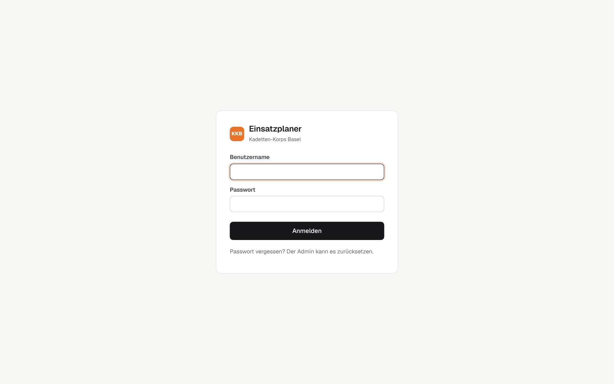
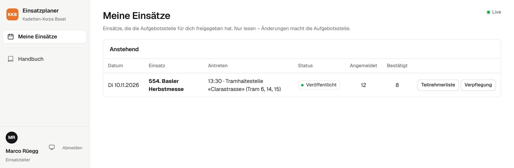
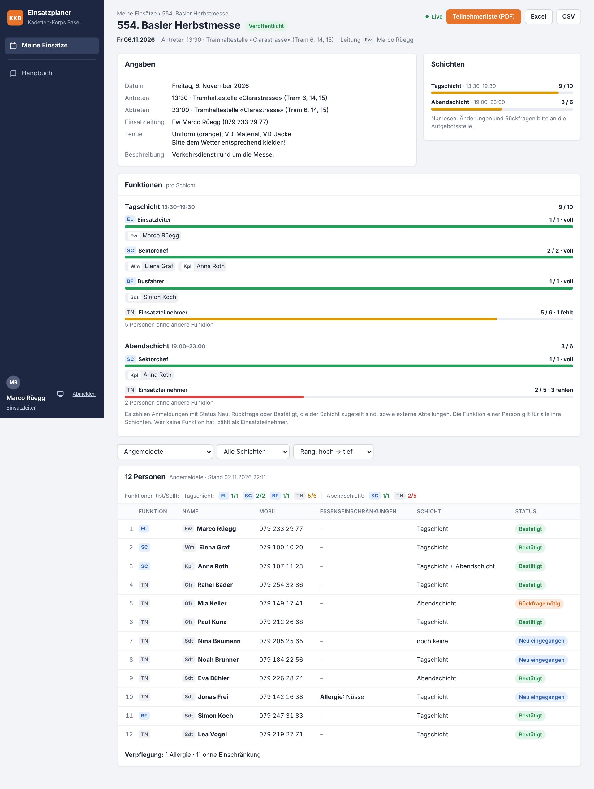
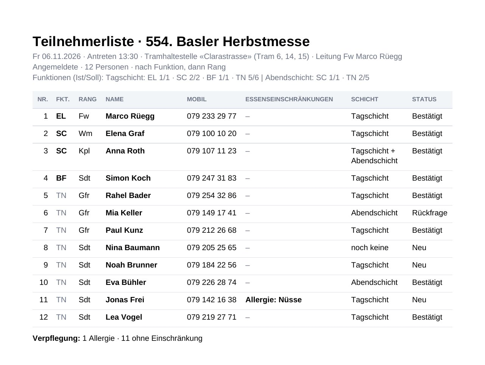
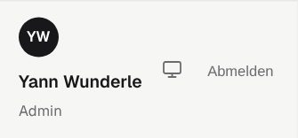

# KKB-Einsatzplaner – Handbuch für Einsatzleiter

Kurzanleitung für alle, die im Einsatzplaner die Rolle **Einsatzleiter** haben. Du siehst damit deine Einsätze mit allen Angaben und der Teilnehmerliste – immer im aktuellen Stand, ohne auf eine Liste per Mail warten zu müssen.

> **Zu den Bildern:** Alle Namen, Zahlen und Telefonnummern in den Bildern sind frei erfunden.

## 1 · Was du als Einsatzleiter siehst

Die Aufgebotsstelle gibt dir einzelne Einsätze frei. Für diese Einsätze siehst du:

- die **Angaben**: Datum, Antreten und Abtreten, Einsatzleitung, Tenue und Beschreibung,
- die **Schichten** mit Zeiten und Besetzung,
- die **Teilnehmer** mit Rang, Mobilnummer, Essenseinschränkungen, Schicht und Status,
- die **Teilnehmerliste** als PDF, Excel oder CSV.

Du kannst nur lesen, nichts ändern. Anmeldungen bestätigen, Schichten einteilen und Angaben anpassen macht die Aufgebotsstelle. Andere Einsätze, die Personenliste und interne Bemerkungen siehst du nicht.

## 2 · Anmelden

1. Die Adresse des Einsatzplaners öffnen (z. B. einsatz.holmium.ch) und ein Lesezeichen setzen – auf dem Handy am besten auf dem Startbildschirm.
2. Mit deinem Benutzernamen und Passwort anmelden. Dein Konto erhältst du von einem Admin. Ist die Microsoft-Anmeldung für dein Konto freigegeben, geht es auch mit «Mit Microsoft anmelden».
3. Ist bei dir die **Zwei-Faktor-Anmeldung** eingerichtet, fragt der Einsatzplaner danach nach dem 6-stelligen Code aus der Authenticator-App (Kapitel 6).
4. Es öffnet sich **Meine Einsätze**.

Musst du beim ersten Anmelden ein neues Passwort wählen, öffnet sich direkt die Seite dafür. Nach 5 falschen Versuchen ist das Konto für 15 Minuten gesperrt. Ein vergessenes Passwort setzt ein Admin zurück.

## 3 · Meine Einsätze

Hier stehen alle Einsätze, die für dich freigegeben sind: **Anstehend** oben, **Vergangen** darunter. Pro Einsatz siehst du Datum, Antreten, Status und wie viele Personen angemeldet und davon schon bestätigt sind.

- Ein Klick auf den **Namen des Einsatzes** öffnet alle Angaben und die Teilnehmer.
- **Teilnehmerliste** öffnet die Liste direkt als PDF in einem neuen Tab.

Gibt dir die Aufgebotsstelle einen weiteren Einsatz frei, erscheint er sofort in der Liste. Steht hier nichts, ist zurzeit kein Einsatz für dich freigegeben – melde dich bei der Aufgebotsstelle.

## 4 · Einen Einsatz ansehen

**Oben** stehen Datum, Antreten und die Einsatzleitung, rechts die Knöpfe für die Teilnehmerliste. Ein Hinweis zeigt, wenn der Einsatz noch ein **Entwurf** ist (Angaben können sich noch ändern) oder **abgesagt** wurde.

**Angaben:** Datum, Antreten und Abtreten mit Ort, Einsatzleitung mit Mobilnummer, Tenue und Beschreibung.

**Schichten:** Pro Schicht die Zeit und die Besetzung, z. B. «8 / 10» – 8 Personen eingeteilt, 10 gebraucht. Der Balken ist grün, wenn die Schicht voll ist, gelb ab der Hälfte und rot darunter. Kommen Leute einer anderen Abteilung, steht darunter z. B. «6 eigene + 4 extern».

**Funktionen:** Hat die Aufgebotsstelle festgelegt, wie viele Einsatzleiter (EL), Sektorchefs (SC), Busfahrer (BF) und Einsatzteilnehmer (TN) es braucht, zeigt diese Karte pro Schicht und Funktion Ist / Soll, z. B. «SC 1 / 2 · 1 fehlt», und wer eingeteilt ist. Die Funktion einer Person gilt in allen ihren Schichten. Wer keine Funktion hat, zählt als Einsatzteilnehmer. Eingeteilt wird von der Aufgebotsstelle.

**Teilnehmer:** Die Tabelle unten zeigt, wer kommt, der höchste Rang zuerst.

| Spalte | Bedeutung |
|---|---|
| Funktion | EL, SC, BF oder TN – erscheint, sobald Funktionen festgelegt sind. |
| Name | Mit Rang. |
| Mobil | Auf dem Handy direkt antippen, um anzurufen. |
| Essenseinschränkungen | Z. B. «vegetarisch» oder «Allergie: Nüsse». «–» heisst keine Einschränkung. |
| Schicht | Erscheint, wenn der Einsatz mehrere Schichten hat. «noch keine» heisst: noch nicht eingeteilt. |
| Status | **Bestätigt** – fix dabei. **Neu eingegangen** und **Rückfrage nötig** – angemeldet, aber von der Aufgebotsstelle noch nicht bestätigt. **Warteliste** – nur bei der Auswahl «Angemeldete + Warteliste». |

Unter der Tabelle stehen die **externen Abteilungen** (Leute anderer Abteilungen, nur mit Anzahl, ohne Namen, z. B. «2× vegetarisch, 1× Allergie: Nüsse») und die **Verpflegung** als Zusammenfassung für die Küche, z. B. «3 vegetarisch · 1 Allergie · 7 ohne Einschränkung». Die Essenseinschränkungen der externen Abteilungen sind darin schon mitgezählt.

**Auswahl über der Tabelle:**

- **Wer steht drauf:** «Angemeldete» (Standard: neu, Rückfrage und bestätigt), «Nur bestätigte» oder «Angemeldete + Warteliste». Abmeldungen und Absagen stehen nie drauf.
- **Schicht:** Bei mehreren Schichten lässt sich die Liste auf eine Schicht einschränken.
- **Sortierung:** «Rang: hoch → tief» oder «Rang: tief → hoch», innerhalb des Rangs alphabetisch, oder «Funktion, dann Rang» (EL, SC, BF zuerst).

Die Seite aktualisiert sich von selbst, sobald die Aufgebotsstelle etwas ändert – die grüne Anzeige **Live** oben rechts zeigt das an. Du musst nicht neu laden.

## 5 · Die Teilnehmerliste

- **Teilnehmerliste (PDF)** öffnet die Liste in einem neuen Tab. Von dort kannst du sie drucken, speichern oder weiterschicken.
- **Excel** und **CSV** laden die Liste als Datei herunter, mit Essenseinschränkung und Details in getrennten Spalten. Externe Abteilungen stehen am Ende als eigene Zeilen mit Rang «extern» und einer Spalte «Anzahl».
- Alle drei übernehmen genau die Auswahl, die du über der Tabelle eingestellt hast (z. B. «Nur bestätigte», nur die Abendschicht).

Die Liste zeigt den Stand im Moment des Öffnens. Hat sich seither etwas geändert, öffne sie einfach neu.

> **Vertraulich:** Die Liste enthält Mobilnummern und Essenseinschränkungen. Gib sie nur an Personen weiter, die sie für den Einsatz brauchen, und lösche Ausdrucke und Dateien nach dem Einsatz. Jedes PDF und jeder Download wird im Verlauf des Einsatzes festgehalten.

Die Essenseinschränkungen siehst du nur, solange der Einsatz bevorsteht. Danach steht in der Spalte «Hinweis vorhanden».

## 6 · Konto, Sicherheit und Darstellung

- Ein Klick unten links auf deinen **Namen** öffnet dein Konto. Dort änderst du das Passwort (mindestens 10 Zeichen).
- Im Konto, Reiter **Zwei-Faktor**, richtest du die Zwei-Faktor-Anmeldung ein: Authenticator-App auf dem Handy installieren (z. B. Microsoft Authenticator oder Google Authenticator), QR-Code scannen, Code eingeben, **Aktivieren**. Die 10 Wiederherstellungscodes aufschreiben und sicher aufbewahren – damit kommst du hinein, falls du dein Handy verlierst.
- Das **Symbol neben deinem Namen** wechselt die Darstellung: «wie System», «Hell» oder «Dunkel».
- **Abmelden** – vor allem auf fremden oder geteilten Geräten. Nach längerer Inaktivität wirst du automatisch abgemeldet.

## 7 · Auf dem Handy

Der Einsatzplaner funktioniert auf jedem Handy im Browser, eine App braucht es nicht. Der Knopf ☰ oben links öffnet das Menü. Tabellen erscheinen als Karten: pro Person ein Block mit den Angaben untereinander. Mobilnummern lassen sich direkt antippen. Die Teilnehmerliste als PDF öffnet sich im Browser des Handys und lässt sich von dort teilen.

## 8 · Häufige Fragen

**Ich sehe meinen Einsatz nicht.**
Die Aufgebotsstelle hat ihn noch nicht für dich freigegeben. Melde dich bei ihr – sobald sie ihn freigibt, erscheint er sofort unter «Meine Einsätze».

**Eine Angabe stimmt nicht oder jemand fehlt auf der Liste.**
Du kannst selbst nichts ändern. Melde es der Aufgebotsstelle; ihre Änderung siehst du sofort.

**Was heisst «Neu eingegangen»?**
Die Person hat sich angemeldet, die Aufgebotsstelle hat sie aber noch nicht bestätigt. Wer sicher dabei ist, siehst du mit der Auswahl «Nur bestätigte».

**Warum steht bei den Essenseinschränkungen «Hinweis vorhanden»?**
Der Einsatz ist vorbei. Zum Schutz der Daten sind die genauen Angaben dann ausgeblendet.

**Kann ich auch frühere Einsätze ansehen?**
Ja, solange die Freigabe besteht. Sie stehen unter «Vergangen».

**Ich habe mein Passwort vergessen oder mein Handy mit der Authenticator-App verloren.**
Mit einem Wiederherstellungscode anmelden (statt des 6-stelligen Codes) und die Zwei-Faktor-Anmeldung neu einrichten. Ohne Code oder bei vergessenem Passwort hilft ein Admin.

**Woher weiss ich, ob dieses Handbuch aktuell ist?**
Oben auf der Handbuch-Seite stehen Stand und Version. Das Handbuch wird mit jedem Update mitgeliefert.
