# KKB-Einsatzplaner – Handbuch

Anleitung für die Aufgebotsstelle und die Admins des Kadetten-Korps Basel. Einsatzleiter sehen unter «Handbuch» ein eigenes, kurzes [Handbuch für Einsatzleiter](/handbuch/einsatzleiter) mit nur ihren Funktionen. Das Handbuch gehört zur installierten Version: Mit jedem Update kommt automatisch der passende Stand mit.

> **Zu den Bildern:** Alle Namen, Zahlen und Telefonnummern in den Bildern sind frei erfunden.

## 1 · Warum ein Einsatzplaner?

Ein Einsatz mit rund 15 Kadettinnen und Kadetten bedeutet viel Kleinarbeit: Anmeldungen sammeln, Fehlende anrufen, Schichten füllen und am Schluss das Aufgebot schreiben. Der Einsatzplaner bündelt all das an einem Ort.

| Aufgabe | Bisher | Mit dem Einsatzplaner |
|---|---|---|
| Anmeldungen sammeln | Aus Formular, Telefon und WhatsApp von Hand zusammentragen | Landen automatisch beim richtigen Einsatz und bei der richtigen Person |
| Wer fehlt noch? | Listen gegeneinander abgleichen | «Rückmeldungen» zeigt für jedes Mitglied An, Ab, Unsicher oder Offen |
| Nachfassen | Steht im Kopf oder im Chatverlauf einer Person | Jeder Anruf und jede WhatsApp ist mit Datum und Absender erfasst – für alle sichtbar |
| Neuer Einsatz auf ClubDesk | Seite oder Formular anpassen | Nichts zu tun: Das Formular reiht neue Einsätze selbst ein |
| Aufgebot verschicken | Text für jeden Einsatz neu schreiben | Kalendertermin per Klick, Text aus unserer Vorlage |
| Zusammenarbeit | Jede Person hat einen anderen Stand | Alle sehen live denselben Stand, ohne neu zu laden |
| Nachvollziehbarkeit | Unklar, wer was wann geändert hat | Jede Änderung ist mit Person und Zeitpunkt protokolliert |

## 2 · Der Ablauf auf einen Blick

Jeder Einsatz durchläuft dieselben Schritte. Die Mitglieder sehen davon nur einen: das Anmeldeformular auf unserer ClubDesk-Seite.

1. **Einsatz anlegen** – Name und Datum genügen für den Anfang, das Soll pro Funktion kommt dazu (Kapitel 5 und 6). Helfen andere Abteilungen mit, nur deren Anzahl erfassen (Kapitel 7).
2. **Veröffentlichen** – der Einsatz erscheint sofort im Anmeldeformular.
3. **Mitglieder melden sich an** – über das Formular, mit Vor- und Nachname (Kapitel 8).
4. **Zuordnen** – der Einsatzplaner erkennt die Person. Was nicht eindeutig ist, landet in den Klärungen (Kapitel 10).
5. **Nachfassen** – wer sich nicht gemeldet hat, wird angerufen oder per WhatsApp angefragt (Kapitel 11).
6. **Bestätigen und einteilen** – jede Anmeldung wird von Hand bestätigt, dann Schichten und Funktionen (EL, SC, BF) besetzen (Kapitel 9, 12 und 6).
7. **Teilnehmerliste** – für Einsatzleitung und Küche als PDF, oder der Einsatzleiter schaut selbst nach (Kapitel 14 und 15).
8. **Aufgebot** – der Kalendertermin mit allen Angaben entsteht per Klick (Kapitel 16).

> **Wichtig:** Niemand gilt automatisch als dabei, nur weil er das Formular ausgefüllt hat. Bestätigt wird immer von Hand durch die Aufgebotsstelle.

## 3 · Erste Schritte

Der Einsatzplaner läuft im Browser – auf dem Computer, dem Tablet oder dem Handy. Es muss nichts installiert werden.

**Auf dem Handy** öffnet der Knopf ☰ oben links das Menü. Tabellen erscheinen dort als Karten: pro Person oder Einsatz ein Block mit den Angaben untereinander. Die Rückmeldungen-Tabelle lässt sich seitwärts wischen. Für grössere Arbeiten wie Schichten planen oder Einstellungen ist der Computer bequemer.

### Anmelden

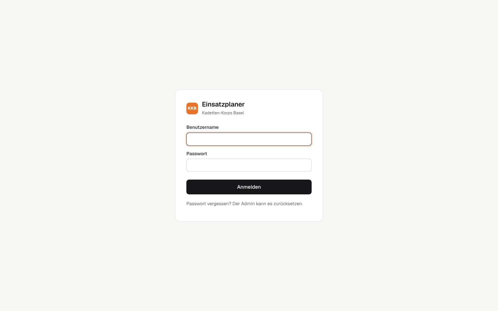

1. Die Adresse des Einsatzplaners öffnen (z. B. einsatz.holmium.ch) und ein Lesezeichen setzen.
2. Mit dem persönlichen Benutzernamen und Passwort anmelden. Jede Person hat ein eigenes Konto – Konten werden nicht geteilt.
   Ist die Microsoft-Anmeldung eingerichtet und für dein Konto freigegeben, geht es auch mit «Mit Microsoft anmelden».
3. Ist die **Zwei-Faktor-Anmeldung** eingerichtet, fragt der Einsatzplaner danach nach dem 6-stelligen Code aus der Authenticator-App (Kapitel 19).
4. Es öffnet sich das Cockpit.

Nach 5 falschen Versuchen (Passwort oder Code) ist das Konto für 15 Minuten gesperrt. Ein vergessenes Passwort setzt ein Admin zurück.

### Wer darf was?

| Rolle | Was diese Rolle kann |
|---|---|
| Aufgebotsstelle | Einsätze und Schichten anlegen und veröffentlichen, Anmeldungen prüfen, zuordnen und bestätigen, Anfragen erfassen, Schichten besetzen, Kalendertermine exportieren, drucken und exportieren, Personen pflegen |
| Admin | Alles, was die Aufgebotsstelle kann, und zusätzlich: Benutzer verwalten, Auswahllisten, Vorlagen, Bestätigungsmail und Einstellungen, Formular-Eingänge, Update und Neustart, Änderungen an abgeschlossenen Einsätzen (mit Begründung) |
| Einsatzleiter | Sieht nur die Einsätze, die die Aufgebotsstelle für ihn freigegeben hat: Angaben, Schichten und Teilnehmerliste (mit Mobil und Essenseinschränkungen), als PDF, Excel oder CSV. Nur lesen – ändern kann er nichts (Kapitel 15) |
| Mitglieder | Haben kein Konto. Sie melden sich nur über das Anmeldeformular auf ClubDesk an |

### Aufbau der Oberfläche

Links steht die Navigation, rechts der Inhalt.

| Bereich | Wofür |
|---|---|
| Cockpit | Startseite: was heute zu tun ist |
| Einsätze | Alle Einsätze; pro Einsatz die Reiter Übersicht, Anmeldungen, Anfragen, Schichten, Formular und Verlauf |
| Rückmeldungen | Wer hat sich wofür gemeldet – als Tabelle oder pro Einsatz |
| Klärungen | Anmeldungen, deren Name nicht sicher zugeordnet werden konnte. Die Zahl zeigt, wie viele offen sind |
| Personen | Stammdaten mit Suche; pro Person eine eigene Seite |
| Formulare | Eingänge des Anmeldeformulars, Fehler und Postausgang (Admin). Die Aufgebotsstelle sieht hier stattdessen **Formular-Vorschau**: das Anmeldeformular, wie es die Mitglieder sehen |
| Einstellungen | Benutzer, Auswahllisten, Vorlagen, Kalendertermin, Bestätigungsmail, Einstellungen, System (Admin) |
| Handbuch | Diese Anleitung, immer im Stand der installierten Version. Oben rechts: **Handbuch für Einsatzleiter** und **Als PDF** |

### Bedienung, die überall gleich ist

- **Live:** Die grüne Anzeige «Live» oben bedeutet, dass sich die Seite von selbst aktualisiert, wenn jemand anderes etwas ändert. Während man selbst etwas eingibt, wartet die Aktualisierung und zeigt stattdessen «Es gibt neue Daten».
- **Suchen beim Tippen:** Alle Suchfelder filtern sofort, Enter ist nicht nötig. Auswahlfelder wie Mannschaft oder Status wirken ebenfalls sofort.
- **Auswahlfelder mit Suche:** Wo man eine Person oder einen Einsatz auswählt, kann man einfach tippen, z. B. «meier chr». Gross-/Kleinschreibung, Umlaute und die Reihenfolge der Wörter spielen keine Rolle.
- **Sortierung nach Rang:** Personenlisten sind standardmässig vom tiefsten zum höchsten Rang sortiert, bei gleichem Rang nach Name. Im Auswahlfeld «Sortierung» lässt sich auf «Rang: hoch → tief» umschalten.
- **Die Stelle bleibt:** Nach dem Speichern kommt man an dieselbe Stelle der Seite zurück.
- **Nichts geht verloren:** Hat ein anderer Teil der Seite noch ungespeicherte Eingaben, fragt der Einsatzplaner vor dem Speichern nach. Beim Verlassen einer Seite mit ungespeicherten Eingaben warnt der Browser.
- **Gleichzeitig bearbeiten:** Bearbeitet jemand denselben Eintrag, steht oben ein Hinweis. Speichern zwei Personen gleichzeitig, zeigt der Einsatzplaner beide Stände an, statt still zu überschreiben.
- **Ein Speichern-Knopf pro Tabelle:** Tabellen zum Bearbeiten (Schichten verwalten, Auswahllisten, Vorlagen) haben unten rechts einen einzigen **Speichern**-Knopf. Mehrere Zeilen ändern, in der leeren untersten Zeile etwas Neues eintragen, dann einmal speichern. Geänderte Zeilen sind links orange markiert, und unten steht «Ungespeicherte Änderungen».
- **Export und Drucken:** Listen lassen sich als Excel oder CSV exportieren – genau mit den eingestellten Filtern – und drucken. Ausdrucke sind immer hell.
- **Handbuch als PDF:** Auf der Seite «Handbuch» öffnet **Als PDF** dieses Handbuch als gestaltetes PDF mit Inhaltsverzeichnis und Seitenzahlen – zum Drucken, Speichern oder Weiterschicken.
- **Die Suche oben rechts** findet Personen, Einsätze und Anmeldungen.

### Konto und Darstellung

- Ein Klick auf den **eigenen Namen** öffnet das Konto: Passwort ändern und Zwei-Faktor-Anmeldung einrichten.
- Das **Symbol daneben** wechselt die Darstellung: «wie System» (Bildschirm), «Hell» (Sonne) oder «Dunkel» (Mond). Die Wahl gilt pro Benutzer auf allen Geräten.

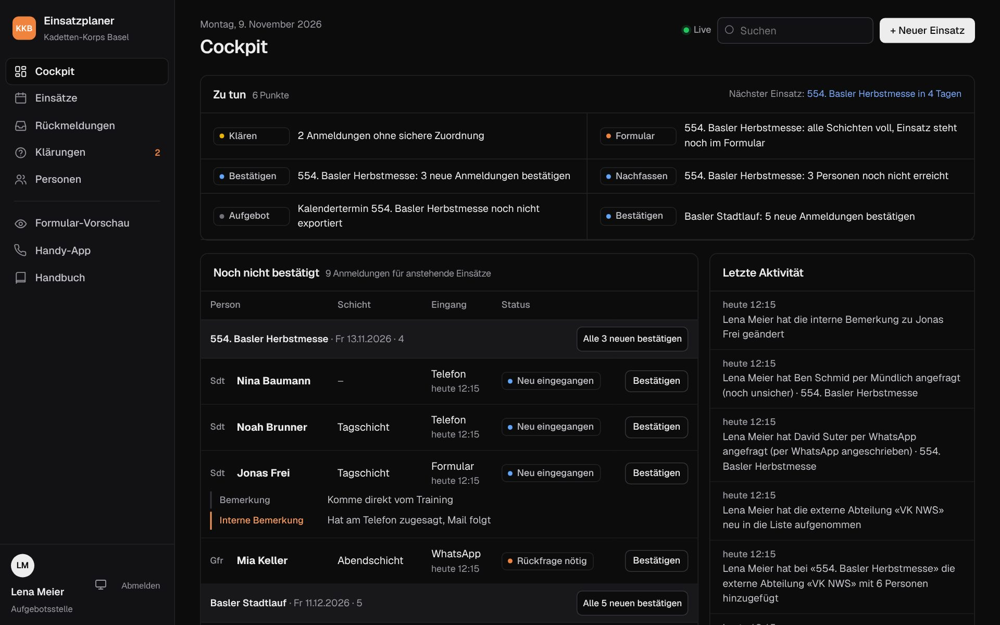

## 4 · Das Cockpit

Das Cockpit beantwortet jeden Tag die Frage: Was ist zu tun?

- **Kennzahlen:** neue Anmeldungen, unklare Namen, noch nicht erreichte Personen und die Tage bis zum nächsten Einsatz.
- **Noch nicht bestätigt:** zuoberst links alle Anmeldungen für anstehende Einsätze mit Status «Neu eingegangen», «Rückfrage nötig» oder «Warteliste», nach Einsatz und Rang geordnet, mit Schicht, Quelle und Zeitpunkt. **Bestätigen** bestätigt direkt aus dem Cockpit. Ein Klick auf den Einsatz öffnet die Anmeldung dort.
- **Anstehende Einsätze:** direkt darunter die Besetzung pro Schicht (Ist / Soll; grün = voll, gelb = teilweise, rot = viele fehlen), dazu wie viele Anmeldungen neu, unsicher oder offen sind. Ein Klick öffnet den Einsatz.
- **Zu tun** (rechts): konkrete Hinweise, z. B. Anmeldungen bestätigen, Personen nachfassen, ein voller Einsatz, der noch im Formular steht, oder ein Aufgebot, das noch nicht exportiert ist.
- **Letzte Aktivität** (rechts, unter «Zu tun»): wer sich wann angemeldet hat, wer wen angefragt und wer was bestätigt hat.

## 5 · Einen Einsatz anlegen und veröffentlichen

### Die Einsatzliste

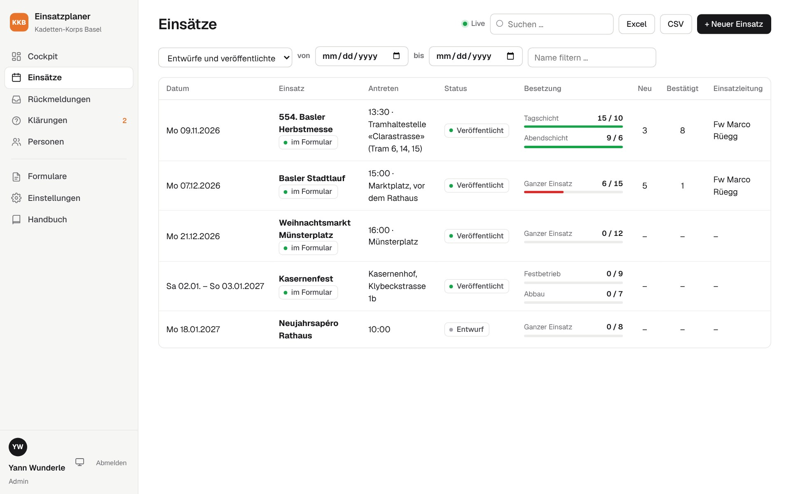

Die Liste zeigt alle Einsätze mit Datum, Antreten, Status, Besetzung und Einsatzleitung. Oben lässt sich nach Status, Zeitraum und Name filtern.

### Neuer Einsatz

Über **+ Neuer Einsatz** öffnet sich das Formular. Nur Name und Datum sind Pflicht – alles andere darf später ergänzt werden.

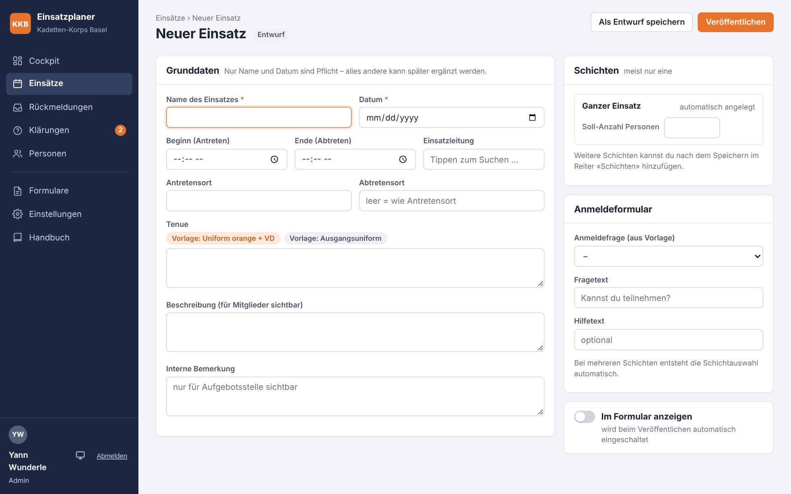

- **Grunddaten:** Name, Datum, Beginn (Antreten) und Ende (Abtreten), Antretens- und Abtretensort. Bleibt der Abtretensort leer, gilt der Antretensort.
- **Einsatzleitung:** aus den Personen wählen (tippen zum Suchen). Rang und Telefonnummer kommen so automatisch ins Aufgebot.
- **Tenue:** mit einem Klick eine Vorlage übernehmen, z. B. «Uniform orange + VD», und bei Bedarf anpassen.
- **Beschreibung** ist für die Mitglieder im Formular sichtbar, die **interne Bemerkung** nur für die Aufgebotsstelle.
- **Schichten:** Eine Schicht für den ganzen Einsatz wird automatisch angelegt. Weitere Schichten kommen nach dem Speichern dazu.
- **Schichten und Soll:** pro Schicht, wie viele Einsatzleiter (EL), Sektorchefs (SC), Busfahrer (BF) und Einsatzteilnehmer (TN) es braucht. Leer lassen, was es nicht braucht. Die Summe ist das Soll der Schicht (Kapitel 6).
- **Anmeldeformular:** Anmeldefrage aus einer Vorlage wählen und Text und Hilfetext anpassen. Die Standard-Vorlage (Einstellungen › Vorlagen) ist bei neuen Einsätzen schon ausgewählt.
- **Als Entwurf speichern** oder direkt **Veröffentlichen** – dann erscheint der Einsatz sofort im Anmeldeformular.

### Die Übersicht eines Einsatzes

- **Kennzahlen:** neu eingegangen, zu prüfen, bestätigt und ohne Rückmeldung.
- **Besetzung** pro Schicht mit Ist / Soll. Helfen externe Abteilungen mit, steht darunter z. B. «8 eigene + 6 extern».
- **Funktionen:** Ist / Soll pro Schicht und Funktion (EL, SC, BF, TN) und wer welche Funktion hat (Kapitel 6).
- **Externe Abteilungen:** andere Abteilungen oder Vereine, die mit einer Anzahl Personen mithelfen (Kapitel 7).
- **Angaben** des Einsatzes und wann das Aufgebot zuletzt exportiert wurde.
- **Status:** Entwurf → Veröffentlicht → Abgeschlossen, oder jederzeit Abgesagt. Nach dem Abschluss sind die Daten schreibgeschützt; Änderungen sind dann nur noch durch einen Admin mit Begründung möglich. Bei einer Absage bleiben alle Daten erhalten.
- **Im Formular anzeigen:** schaltet den Einsatz im Anmeldeformular ein oder aus, z. B. wenn er voll ist.
- **Checkliste:** zeigt, welche Angaben noch fehlen.
- **Einsatzleiter-Zugriff:** gibt den Einsatz für einen Einsatzleiter frei (Kapitel 15).
- Oben gibt es **Kalendertermin** (Kapitel 16), **Drucken** bzw. **Export**, **Teilnehmerliste** (Kapitel 14) und **Bearbeiten**.

### Reiter «Formular»

Zeigt genau, wie der Einsatz im Anmeldeformular aussieht, und bis wann er dort steht. «Vorschau öffnen» zeigt das ganze Formular in einem neuen Fenster; Absenden ist in der Vorschau deaktiviert.

### Reiter «Verlauf»

Jede Änderung am Einsatz, an Anmeldungen und Anfragen steht hier mit Zeitpunkt und Person.

## 6 · Funktionen und Soll (EL, SC, BF, TN)

Pro Einsatz legst du fest, wie viele Personen es von jeder Funktion braucht, und teilst die Angemeldeten ein. So siehst du auf einen Blick, ob z. B. noch ein Sektorchef oder der Busfahrer fehlt.

| Kürzel | Funktion |
|---|---|
| **EL** | Einsatzleiter |
| **SC** | Sektorchef |
| **BF** | Busfahrer |
| **TN** | Einsatzteilnehmer (Standard) |

Welche Funktionen es gibt, legt ein Admin unter Einstellungen › Auswahllisten › **Funktionen an Einsätzen** fest (Kapitel 18).

### Soll festlegen

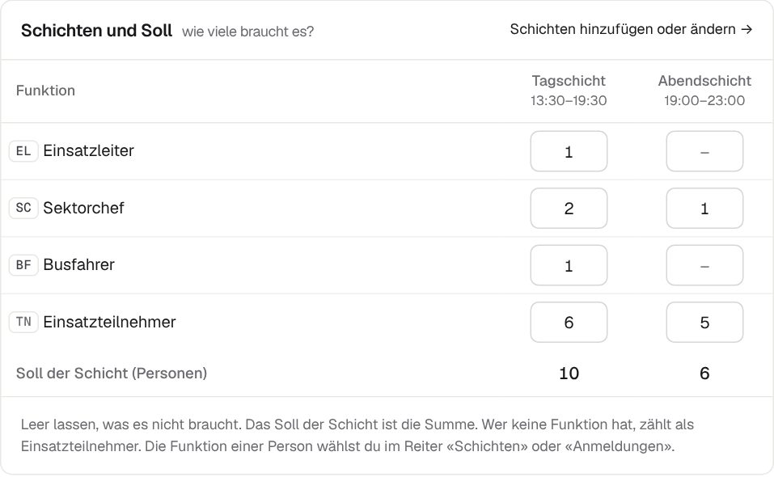

Das Soll gibt es **pro Schicht und Funktion**. Beim Anlegen oder unter **Bearbeiten** in der Karte **Schichten und Soll** steht eine Spalte pro Schicht; dort die Anzahl pro Funktion eintragen, z. B. Tagschicht 1 EL, 2 SC, 1 BF, 6 TN und Abendschicht 1 SC, 5 TN. Leer oder 0 heisst: braucht es nicht.

Dasselbe geht im Reiter **Schichten** unter **Schichten verwalten**: eine Zeile pro Schicht mit den Spalten EL, SC, BF und TN, auch für eine neue Schicht. Die ganze Tabelle hat einen einzigen **Speichern**-Knopf (Kapitel 12).

Das **Soll der Schicht** ist immer die Summe davon (im Beispiel 10 und 6) – ein separates Feld dafür gibt es nicht. Einsätze, die früher nur eine Soll-Anzahl pro Schicht hatten, wurden beim Update übernommen: Die Zahl steht jetzt bei den Einsatzteilnehmern.

### Funktionen zuweisen

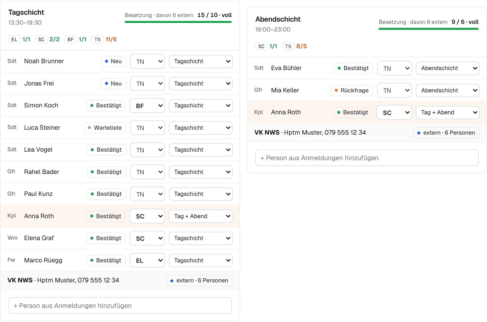

Es gibt drei Wege:

- In der **Übersicht**, Karte **Funktionen**: unter jeder Funktion im Auswahlfeld **+ EL zuweisen …** (bzw. SC, BF) eine angemeldete Person wählen (tippen zum Suchen). Das **✕** beim Namen nimmt die Funktion wieder weg.
- Im Reiter **Anmeldungen** in der Spalte **Funktion** direkt pro Zeile umstellen.
- Im Reiter **Anmeldungen** mehrere ankreuzen und oben **Funktion zuweisen …** wählen.

Wer keine Funktion zugewiesen hat, zählt automatisch als **Einsatzteilnehmer (TN)**. Du musst also nur EL, SC und BF einteilen.

### Was die Karte «Funktionen» zeigt

- Pro Schicht und Funktion **Ist / Soll** mit Balken: grün = genau voll, gelb/rot = es fehlen noch welche, orange = zu viele (z. B. «2 / 1 · 1 zu viel»). Rechts beim Schichtnamen das Total der Schicht. Bei mehreren Schichten stehen nur die Funktionen, die in dieser Schicht ein Soll haben oder besetzt sind.
- Es zählen wie bei der Besetzung die Anmeldungen mit Status Neu, Rückfrage oder Bestätigt, die der Schicht zugeteilt sind. Warteliste und Abmeldungen zählen nicht; Abgemeldete bekommen keine Funktion.
- Die Funktion einer **Person** gilt für den ganzen Einsatz: Wer als SC eingeteilt ist und in der Tag- und der Abendschicht arbeitet, zählt in beiden Schichten als SC. Im Reiter «Schichten» steht das Kürzel (z. B. «SC») neben dem Namen und unter jeder Schicht die Zeile Ist / Soll pro Funktion.
- **Externe Abteilungen** zählen mit ihrer Anzahl Personen in ihren Schichten – standardmässig als Einsatzteilnehmer. Stellt eine Abteilung z. B. den Busfahrer, beim Erfassen der Abteilung **Funktion** auf «BF» stellen (Kapitel 7).

Die Funktionen stehen auch auf der **Teilnehmerliste** (Spalte «Fkt.» bzw. «Funktion» und oben «Funktionen (Ist/Soll)»), auf der Seite des Mitglieds, in der Einsatzliste beim Export und in der Ansicht der Einsatzleiter. Jede Zuweisung steht im Verlauf.

> **Funktion EL ≠ Rolle «Einsatzleiter»:** Die **Funktion** EL sagt, wer an diesem Einsatz die Leitung hat. Die **Benutzer-Rolle** «Einsatzleiter» ist ein Login, mit dem jemand freigegebene Einsätze ansehen kann (Kapitel 15). Hat eine Person mit Funktion EL (oder SC, BF) ein Einsatzleiter-Konto, schlägt die Karte **Einsatzleiter-Zugriff** vor, ihr den Einsatz freizugeben – freigeben musst du aber selbst mit einem Klick. Das Feld **Einsatzleitung** bei den Angaben bleibt unabhängig davon die Hauptverantwortung, die ins Aufgebot kommt.

## 7 · Externe Abteilungen

Manchmal helfen andere Abteilungen oder Vereine mit, z. B. die Feuerwehr, die Verkehrskadetten einer anderen Region oder ein Samariterverein. Von ihnen braucht es keine Namen, nur **welche Abteilung** und **wie viele Personen** kommen.

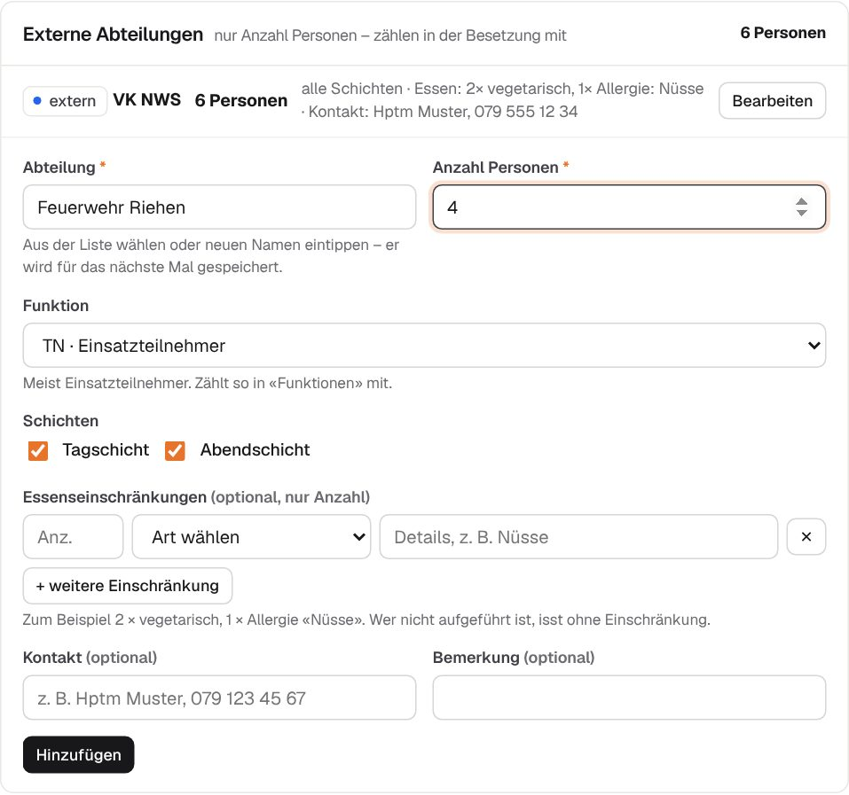

### Abteilung erfassen

1. In der **Übersicht** des Einsatzes auf **+ Externe Abteilung hinzufügen** klicken.
2. **Abteilung:** aus der Liste wählen oder einen neuen Namen eintippen, z. B. «VK NWS». Ein neuer Name wird automatisch in die Liste aufgenommen und beim nächsten Einsatz vorgeschlagen. Gross- und Kleinschreibung spielt keine Rolle.
3. **Anzahl Personen** eintragen.
4. **Funktion:** meist Einsatzteilnehmer. Stellt die Abteilung z. B. den Busfahrer, hier «BF» wählen – die Personen zählen dann in den Funktionen dort mit (Kapitel 6).
5. **Schichten:** Hat der Einsatz mehrere Schichten, ankreuzen, in welchen die Abteilung mithilft. Sind alle angekreuzt, gilt sie für den ganzen Einsatz, auch für später hinzugefügte Schichten.
6. **Kontakt** (z. B. «Hptm Muster, 079 …») und **Bemerkung** sind freiwillig.

Mit **Bearbeiten** lassen sich die Angaben ändern oder die Abteilung **vom Einsatz entfernen**. Jede Änderung steht im Verlauf des Einsatzes.

### Essenseinschränkungen der Abteilung

Freiwillig lässt sich erfassen, wie viele Personen der Abteilung eine Essenseinschränkung haben – auch hier ohne Namen:

- Pro Zeile die **Anzahl** Personen, die **Art** (vegetarisch, vegan, Allergie, Unverträglichkeit, religiös, andere) und bei Bedarf **Details**, z. B. «2 · vegetarisch» und «1 · Allergie · Nüsse».
- **+ weitere Einschränkung** fügt eine Zeile hinzu, **✕** entfernt sie.
- Wer nicht aufgeführt ist, isst ohne Einschränkung. Es können nicht mehr Einschränkungen als Personen erfasst werden.

### Was die externen Personen bewirken

- Sie **zählen in der Besetzung mit** (Ist / Soll) – in der Übersicht («8 eigene + 6 extern»), im Cockpit, in der Einsatzliste und unter «Schichten». Ist eine Schicht damit voll, erscheint der übliche Hinweis.
- In den **Rückmeldungen** steht die Zahl zusätzlich, z. B. «9 + 6 ext. / 10».
- Auf der **Teilnehmerliste** (Seite, PDF, Excel, CSV) stehen sie in einem eigenen Abschnitt mit Anzahl, Schicht, Essenseinschränkungen, Kontakt und Bemerkung. Oben steht das Total, z. B. «11 Personen + 9 extern = 20 total».
- In der **Verpflegung** unter der Teilnehmerliste zählen ihre Essenseinschränkungen zu denen der eigenen Leute dazu, z. B. «3 vegetarisch». Die übrigen Personen der Abteilung zählen als «ohne Einschränkung». Hat eine Abteilung gar keine Essenseinschränkungen eingetragen, erscheinen ihre Personen als «extern (keine Angaben)».

Die Liste aller Abteilungen pflegt ein Admin unter Einstellungen › Auswahllisten (Kapitel 18).

## 8 · So melden sich die Mitglieder an

Es gibt ein einziges, gemeinsames Anmeldeformular für alle Einsätze. Es ist einmal auf der ClubDesk-Seite eingebettet und zeigt immer genau die Einsätze, für die man sich gerade anmelden kann.

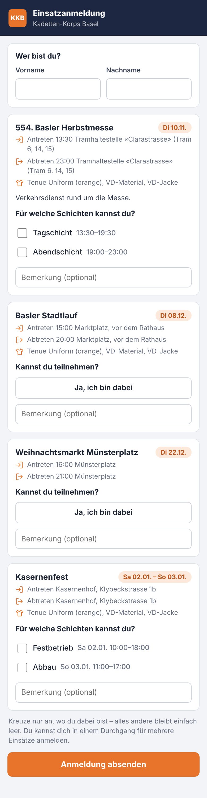

- **Vor- und Nachname** – mehr braucht es nicht. Ein Konto ist nicht nötig.
- Pro Einsatz stehen Datum, **Antreten** und **Abtreten** (jeweils Zeit und Ort) sowie das **Tenue**.
- **Mehrere Schichten:** die gewünschten Schichten ankreuzen.
- **Eine Schicht:** «Ja, ich bin dabei» antippen. Wer nicht kann, lässt den Einsatz einfach leer.
- Eine **Bemerkung** ist pro Einsatz möglich.
- Man kann sich in einem Durchgang für mehrere Einsätze anmelden.

Die Bestätigungsseite erscheint erst, wenn die Anmeldung sicher gespeichert ist, und weist darauf hin, dass sie noch nicht bestätigt ist.

### Wann ein Einsatz im Formular steht

| Situation | Was passiert |
|---|---|
| Einsatz wird veröffentlicht | Er erscheint sofort im Formular. Auf ClubDesk ist nichts zu tun |
| Einsatz ist voll oder abgesagt | Die Aufgebotsstelle nimmt ihn mit dem Schalter «Im Formular anzeigen» heraus. Das Cockpit erinnert daran |
| Letzte Schicht ist vorbei | Der Einsatz verschwindet automatisch aus dem Formular |
| Einzelne Schicht ist vorbei | Diese Schicht wird nicht mehr angeboten |

> **Gut zu wissen:** Wie viele sich schon angemeldet haben, sehen die Mitglieder nicht. Doppelt abgeschickte Formulare werden erkannt, und Spam wird über ein verstecktes Feld und eine Mindestzeit abgefangen.

## 9 · Anmeldungen bearbeiten und bestätigen

Jede Anmeldung landet automatisch beim richtigen Einsatz – egal ob sie über das Formular, per Telefon oder per WhatsApp kam.

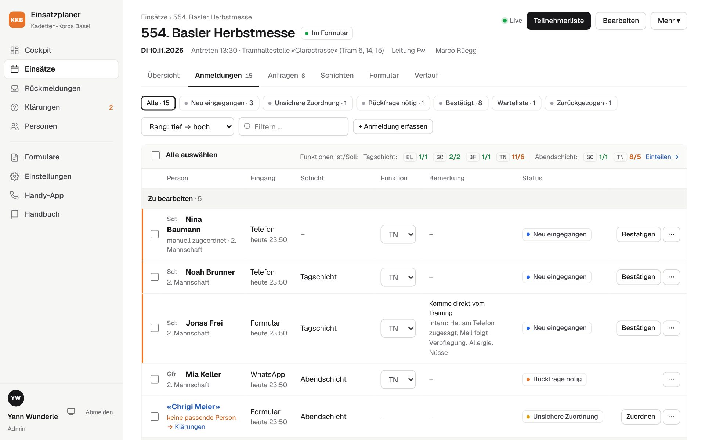

- **Zähler pro Status** oben: ein Klick filtert die Liste.
- **Sortierung:** «Rang: tief → hoch» (Standard), «Rang: hoch → tief», «Funktion, dann Rang» oder «neueste zuerst». Daneben das Suchfeld.
- **Funktionen (Ist/Soll)** stehen über der Tabelle (pro Schicht), sobald beim Einsatz EL, SC oder BF vorkommen.
- **Spalte «Funktion»:** EL, SC, BF oder TN direkt umstellen (Kapitel 6).
- **Sammelaktionen:** mehrere Anmeldungen ankreuzen und gemeinsam bestätigen, den Status ändern, eine **Funktion zuweisen** oder exportieren.
- **Bestätigen** direkt in der Zeile. Orange markierte Zeilen sind noch nicht bestätigt.
- Bemerkungen der Mitglieder und Hinweise zur Verpflegung stehen in der Spalte «Bemerkung».

### Das Menü «…» einer Anmeldung

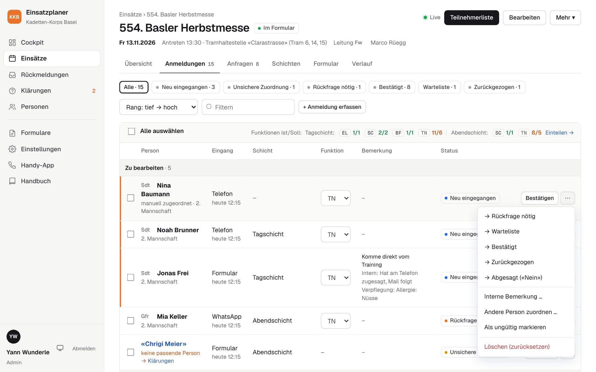

- Status setzen: Rückfrage nötig, Warteliste, Bestätigt, Zurückgezogen, Abgesagt.
- **Interne Bemerkung** festhalten.
- **Andere Person zuordnen**, falls die Zuordnung falsch war.
- **Als ungültig markieren**, z. B. bei einer Spass-Anmeldung.
- **Löschen (zurücksetzen):** entfernt die Anmeldung ganz, als wäre sie nie eingegangen. Eine daraus entstandene Anfrage wird wieder «offen». Der ursprüngliche Formular-Eingang bleibt unter «Formulare» erhalten.

### Anmeldung von Hand erfassen

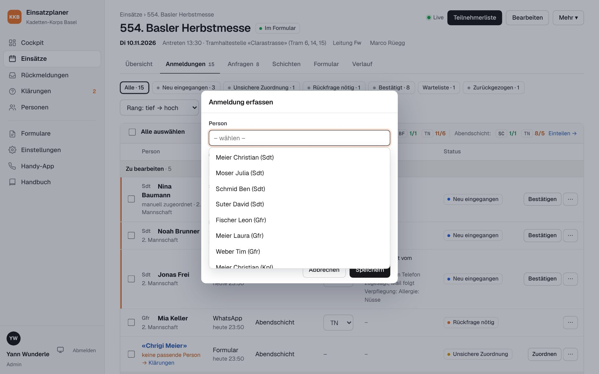

Mit **+ Anmeldung erfassen** lässt sich eine Anmeldung per Telefon, WhatsApp oder mündlich eintragen. Im Feld «Person» einfach den Namen tippen.

### Die Status einer Anmeldung

| Status | Bedeutung | Zählt zur Besetzung |
|---|---|---|
| Neu eingegangen | Formular abgeschickt oder Zusage erfasst, noch nicht bearbeitet | ja |
| Unsichere Zuordnung | Name konnte nicht sicher zugeordnet werden (Kapitel 10) | nein |
| Rückfrage nötig | Es gibt noch etwas zu klären, z. B. «erst ab 19:30» | ja |
| Warteliste | Gültig, aber die Schichten sind voll | nein |
| Bestätigt | Teilnahme verbindlich bestätigt | ja |
| Zurückgezogen | Hat sich wieder abgemeldet | nein |
| Abgesagt | Hat abgesagt | nein |
| Ungültig | z. B. Test- oder Spass-Anmeldung | nein |

> **Nach dem Bestätigen** erhält das Mitglied automatisch eine Anmeldebestätigung per E-Mail, sofern eine Adresse hinterlegt ist und die Bestätigungsmail eingeschaltet ist (Kapitel 18).

## 10 · Unklare Namen zuordnen

Der Einsatzplaner ordnet einen Namen nur dann automatisch zu, wenn er eindeutig ist. Alles andere landet in den **Klärungen** – nichts wird geraten, und es werden nie selbständig neue Personen angelegt.

- **Mehrdeutig:** Es gibt zwei Personen mit demselben Namen, z. B. zweimal «Christian Meier».
- **Unbekannt:** Der Name passt zu niemandem, z. B. ein Spitzname wie «Chrigi Meier».

So geht's:

1. Links die offene Klärung wählen. Eingegebener Name, Quelle und Bemerkung stehen oben.
2. Im Suchfeld die Person suchen (die Liste filtert beim Tippen). Jahrgang und Mannschaft helfen bei gleichen Namen.
3. **Zuordnen** klicken. Mit **«… als Namensvariante speichern»** wird diese Schreibweise beim nächsten Mal automatisch erkannt.
4. Gibt es die Person noch nicht: **Neue Person anlegen**. Unsinn: **Als ungültig markieren**.

Gross- und Kleinschreibung, Leerzeichen, Umlaute (ä/ae) und vertauschte Vor- und Nachnamen erkennt der Einsatzplaner selbst.

## 11 · Nachfassen per Telefon und WhatsApp

Der Reiter **Anfragen** zeigt alle aktiven Mitglieder, die sich für diesen Einsatz noch nicht gemeldet haben, und alle, die schon angefragt wurden. Die Zahl im Reiter zeigt die offenen Nachfass-Fälle.

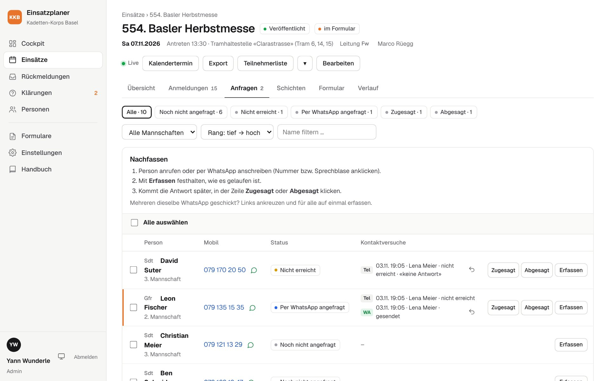

**So geht Nachfassen** (steht auch oben im Reiter):

1. Person anrufen oder per WhatsApp anschreiben. Die **Mobilnummer** ist ein Anruf-Link, das Sprechblasen-Symbol daneben öffnet direkt den **WhatsApp-Chat**.
2. Mit **Erfassen** festhalten, wie es gelaufen ist (z. B. «nicht erreicht» oder «Nachricht gesendet»).
3. Kommt die Antwort später, in der Zeile **Zugesagt** oder **Abgesagt** klicken.

Weitere Hilfen im Reiter:

- **Filter oben:** Ein Klick zeigt nur die Personen mit diesem Status, z. B. **Noch nicht angefragt** = alle, die noch niemand kontaktiert hat. **Alle** zeigt wieder die ganze Liste. Daneben Mannschaft, Sortierung nach Rang und Namenssuche.
- **Kontaktversuche** stehen mit Kanal (Tel / WA), Datum, Uhrzeit, wer es war, Ergebnis und Notiz.
- Der **Pfeil** beim letzten Kontaktversuch nimmt ihn zurück, falls er falsch erfasst wurde. Hat er eine Anmeldung erzeugt, wird diese mitgelöscht.
- **Mehrere auf einmal:** Hat man mehreren dieselbe WhatsApp geschickt, kreuzt man sie links an. Dann erscheint der Knopf **Kontakt für 3 Personen erfassen** (mit der Anzahl), und man erfasst den Kontakt für alle in einem Schritt. **Alle auswählen** kreuzt die ganze (gefilterte) Liste an.

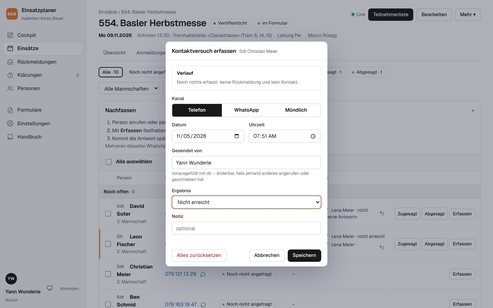

Im Fenster wählt man Kanal, Datum und Uhrzeit (vorausgefüllt mit jetzt), **Gesendet von** (vorausgefüllt mit dem eigenen Namen, änderbar), das Ergebnis und eine Notiz. Bei «Zugesagt» und einem Einsatz mit mehreren Schichten wählt man zusätzlich die Schichten.

**Alles zurücksetzen:** Unten links im Fenster löscht **Alles zurücksetzen** für diese Person und diesen Einsatz alle Kontaktversuche, die Rückmeldung bzw. Anmeldung und die Schichtzuteilung. Die Person steht danach wieder als «Noch nicht angefragt» in der Liste. Vorher fragt der Einsatzplaner nach. Ein Formular-Eingang bleibt unter «Formulare» gespeichert. Bei Personen, die schon zugesagt haben oder selbst gemeldet sind, steht dafür in der Anfragen-Liste rechts das Symbol ↶. Einen einzelnen falsch erfassten Kontaktversuch nimmt man dagegen mit dem ↶ direkt neben dem Versuch zurück.

### Das Ergebnis einer Anfrage

| Status | Bedeutung | Was danach passiert |
|---|---|---|
| Noch nicht angefragt | Noch niemand hat die Person kontaktiert | – |
| Nicht erreicht | Telefonisch nicht erreicht | Bleibt oben in der Liste zum Nachfassen |
| Per WhatsApp angefragt | Nachricht gesendet, Antwort offen | Kommt die Antwort, «Zugesagt» oder «Abgesagt» klicken |
| Unsicher | «Weiss es noch nicht» | Bleibt ein offener Fall, bis die Antwort kommt |
| Zugesagt | Am Telefon oder per WhatsApp zugesagt | Es wird automatisch eine Anmeldung mit Quelle Telefon bzw. WhatsApp erstellt |
| Abgesagt | Kommt nicht | Wird für diesen Einsatz nicht mehr vorgeschlagen |
| Selbst gemeldet | Hat sich inzwischen selbst angemeldet | Erledigt, steht am Schluss der Liste |

> **Beispiel:** David Suter wurde am 26.10. und am 27.10. von Lena Meier angerufen, beide Male ohne Erfolg. Am Abend schreibt Anna Roth ihm per WhatsApp und erfasst das. Am nächsten Tag sieht die ganze Aufgebotsstelle, dass er schon zweimal angerufen und einmal angeschrieben wurde – niemand ruft ihn ein drittes Mal an.

## 12 · Schichten besetzen

Die meisten Einsätze haben nur eine Schicht für alle. Dann gibt es nichts zu verteilen: Jede Anmeldung gilt automatisch für diese Schicht.

- Jede Schicht ist eine Spalte mit Zeit und Besetzung (Ist / Soll). Grün heisst voll. Darunter Ist / Soll pro Funktion, z. B. «EL 1/1 · SC 2/2 · TN 5/6».
- **Schichten verwalten** (unten): Name, Zeit und das Soll pro Funktion (Spalten EL, SC, BF, TN). Die Spalte «Soll» zeigt die Summe und rechnet beim Tippen mit. Die Tabelle hat **einen einzigen Speichern-Knopf** unten rechts: mehrere Schichten ändern, bei Bedarf in der untersten Zeile eine neue Schicht eintragen, dann einmal **Speichern**. Geänderte Zeilen sind links orange markiert, und der Fuss der Tabelle zeigt «Ungespeicherte Änderungen». **+ Hinzufügen** in der neuen Zeile speichert ebenfalls alles auf einmal. **Löschen** wirkt sofort pro Zeile (mit Rückfrage). Ist eine Zeile ungültig, z. B. eine angefangene neue Schicht ohne Namen, wird nichts gespeichert.
- **Noch keiner Schicht zugeteilt:** Anmeldungen ohne Schicht stehen oben und werden über «zuteilen …» eingeteilt.
- **Umteilen** über das Auswahlfeld bei der Person. Eine Person kann auch mehreren Schichten zugeteilt sein («Tag + Abend»).
- **+ Person aus Anmeldungen hinzufügen:** Name tippen und auswählen.
- **Überschneidung:** Ist jemand zwei Schichten zugeteilt, die sich zeitlich überlappen, erscheint oben ein Hinweis. Er blockiert nichts.
- Die Schichtwünsche aus dem Formular sind schon übernommen. Meldet sich eine eingeteilte Person ab, wird die Besetzung sofort angepasst.
- **Externe Abteilungen** stehen am Ende der Spalte ihrer Schicht (Markierung «extern», mit Anzahl Personen) und zählen zur Besetzung, z. B. «Besetzung · davon 6 extern». Erfasst und geändert werden sie in der Übersicht des Einsatzes.

## 13 · Rückmeldungen und Mitgliederseite

Die Seite **Rückmeldungen** beantwortet die wichtigste Frage der Aufgebotsstelle: Wer hat sich für welchen Einsatz gemeldet – und wer noch nicht?

### Ansicht «Tabelle»

- Mitglieder als Zeilen, Einsätze als Spalten. Kopfzeile und Namensspalte bleiben beim Scrollen stehen.
- Im Spaltenkopf jedes Einsatzes steht die Besetzung als Balken, z. B. «11 / 16».
- **Symbole:** ✓ An, ✕ Ab, ? Unsicher, leeres Feld = Offen.
- Ein Klick auf ein Feld öffnet immer das Fenster für einen Kontaktversuch, auch bei ✓ oder ✕. Oben steht der aktuelle Stand (z. B. «An · Anmeldung: Bestätigt · Formular») mit einem Link zur Anmeldung. Dort lässt sich auch **«Unsicher – weiss es noch nicht»** eintragen oder mit **Alles zurücksetzen** neu beginnen. Erfasst man bei einer bestehenden Anmeldung «Abgesagt», wird sie als zurückgezogen markiert. «Zugesagt» macht eine zurückgezogene Anmeldung wieder aktiv.
- Unten stehen pro Einsatz die Summen An · Ab · Unsicher · Offen.
- **Einsätze mit mehreren Schichten** haben eine Spalte pro Schicht, mit eigener Besetzung (z. B. «Tagschicht 8 / 10»). ✓ heisst: für diese Schicht angemeldet oder eingeteilt. – heisst: angemeldet, aber für eine andere Schicht. Ein gestricheltes ✓ heisst: zugesagt, aber die Schicht ist noch nicht festgelegt. Ab, Unsicher und Offen gelten für alle Schichten des Einsatzes.
- Klickt man in einer Schicht-Spalte auf ein offenes Feld und wählt **«Zugesagt»**, ist diese Schicht schon angekreuzt. Weitere Schichten lassen sich dazu wählen, oder man lässt die Auswahl leer und teilt später unter «Schichten» zu. Das gilt genauso beim Erfassen unter Einsatz › Anfragen und auf der Seite eines Mitglieds.

### Ansicht «Pro Einsatz»

Eine Karte pro Einsatz mit den Namen, gruppiert nach An, Unsicher, Ab und Offen. Bei mehreren Schichten steht «An» aufgeteilt nach Schicht, jeweils mit Besetzung, dazu «An, Schicht noch offen» mit Link zum Zuteilen. Ein Klick auf einen offenen Namen erfasst direkt eine Anfrage. Diese Ansicht ist besonders übersichtlich, wenn viele Einsätze anstehen.

### Filter

Namenssuche, Zeitraum (nächste 2 Wochen bis nächstes Jahr), Mannschaft, «Nur mit offenen Einsätzen» oder «Nur mit Unsicheren», Sortierung (Rang tief → hoch oder hoch → tief, nach Name, meiste offen zuerst) und «Entwürfe» einblenden.

| Anzeige | Bedeutung |
|---|---|
| An | Angemeldet – über das Formular, telefonisch oder per WhatsApp |
| Ab | Abgesagt oder wieder abgemeldet |
| Unsicher | Nicht erreicht, WhatsApp ohne Antwort, «weiss es noch nicht» oder Anmeldung mit offener Frage |
| Offen | Noch keine Rückmeldung und noch nicht angefragt |
| Andere Schicht (–) | Angemeldet, aber für eine andere Schicht dieses Einsatzes |
| An, Schicht offen (gestricheltes ✓) | Zugesagt, Schicht noch nicht festgelegt |

### Die Seite eines Mitglieds

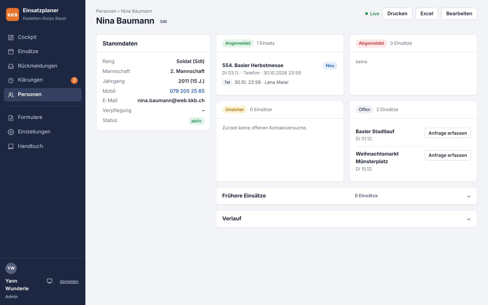

- Links die wichtigsten **Stammdaten**.
- Die Einsätze nach **Angemeldet, Abgemeldet, Unsicher und Offen**, jeweils mit Datum und wie die Rückmeldung kam.
- Offene Einsätze lassen sich direkt mit **Anfrage erfassen** nachfassen.
- **Frühere Einsätze** und der **Verlauf** sind zuklappbar. Die Seite lässt sich drucken und nach Excel exportieren.

## 14 · Die Teilnehmerliste

Die Teilnehmerliste zeigt auf einen Blick, wer kommt – mit **Rang, Name, Mobilnummer und Essenseinschränkungen**, der tiefste Rang zuerst. Sie ist das, was die Einsatzleitung und die Küche brauchen.

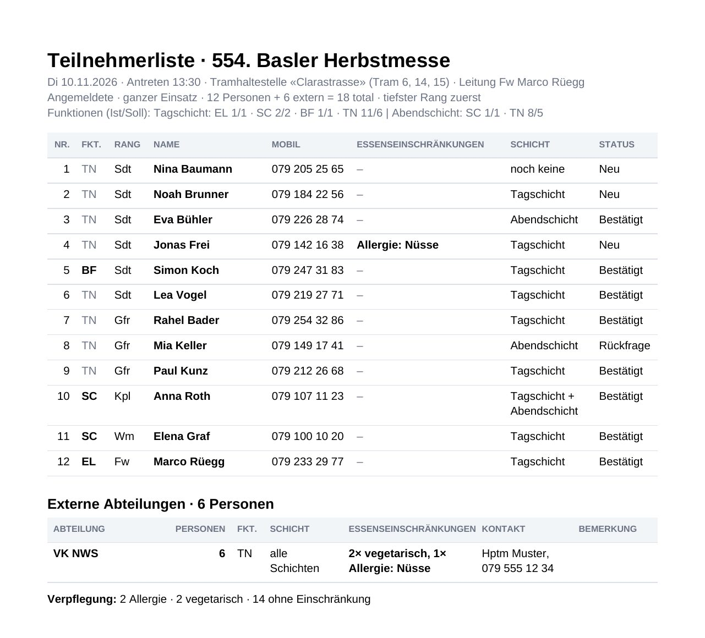

### Als PDF öffnen

Ein Klick auf **Teilnehmerliste** oben auf jeder Seite des Einsatzes öffnet sie sofort als **PDF in einem neuen Tab**. Von dort lässt sie sich drucken, speichern oder weiterschicken.

- Oben stehen Datum, Antreten, Einsatzleitung und die Anzahl Personen, z. B. «11 Personen + 9 extern = 20 total».
- Werden beim Einsatz Funktionen ausser Einsatzteilnehmer verwendet, zeigt eine Spalte **Funktion** das Kürzel (EL, SC, BF, TN), und oben steht «Funktionen (Ist/Soll)», bei mehreren Schichten pro Schicht, z. B. «EL 1/1 · SC 2/2 · BF 1/1 · TN 8/12».
- **Externe Abteilungen** stehen in einem eigenen Abschnitt unter den Personen, mit Anzahl, Schicht, Essenseinschränkungen, Kontakt und Bemerkung.
- Unter der Liste steht die **Verpflegung** als Zusammenfassung für die Küche, z. B. «2 vegetarisch · 1 Allergie · 7 ohne Einschränkung» – die externen Abteilungen sind mitgezählt.

### Excel, CSV und Auswahl

Der kleine Pfeil **▾** neben dem Knopf bietet die Liste auch als **Excel** oder **CSV** an, mit Essenseinschränkung und Details in getrennten Spalten. Externe Abteilungen kommen dort als eigene Zeilen mit Rang «extern» und einer Spalte «Anzahl» ans Ende.

**Auswahl anpassen …** (ebenfalls im Pfeil-Menü) zeigt die Liste in der App und lässt wählen:

- **Wer steht drauf:** «Angemeldete» (neu, Rückfrage und bestätigt – wie die Besetzung), «Nur bestätigte» oder «Angemeldete + Warteliste». Abmeldungen, Absagen und ungültige Anmeldungen stehen nie drauf.
- **Schicht:** Hat der Einsatz mehrere Schichten, lässt sich die Liste auf eine Schicht einschränken; dann erscheinen auch nur die externen Abteilungen dieser Schicht. Sonst zeigt eine Spalte, wer in welcher Schicht ist.
- **Sortierung:** Rang tief → hoch (Standard) oder hoch → tief, innerhalb des Rangs alphabetisch, oder **Funktion, dann Rang** (EL, SC, BF zuerst, dann die Einsatzteilnehmer).
- **PDF öffnen**, **Excel** und **CSV** übernehmen genau diese Auswahl.

Anmeldungen, die noch keiner Person zugeordnet sind, fehlen in der Liste. Die Seite «Auswahl anpassen» weist mit einem Link zu den Klärungen darauf hin. Jedes PDF und jeder Download wird im Verlauf des Einsatzes festgehalten.

> **Sensible Angaben:** Die Essenseinschränkungen stehen für alle angemeldeten Personen drin, solange der Einsatz bevorsteht. Nach dem Einsatz zeigt die Liste der Aufgebotsstelle nur noch «Hinweis vorhanden»; die genaue Angabe sieht dann nur noch ein Admin.

## 15 · Einsatzleiter

Mit der Rolle **Einsatzleiter** kann die Leitung eines Einsatzes selbst nachschauen, wer kommt – mit allen Angaben und der Teilnehmerliste, immer im aktuellen Stand. Niemand muss ihr mehr Listen per Mail schicken.

### Konto anlegen

Ein Admin legt unter Einstellungen › **Benutzer** ein Konto mit der Rolle **Einsatzleiter** an und verknüpft es am besten mit der Person aus den Stammdaten (Kapitel 18). Dann wird das Konto bei Einsätzen, bei denen diese Person die Einsatzleitung hat oder eine Funktion wie EL hat, automatisch zum Freigeben vorgeschlagen.

### Einen Einsatz freigeben

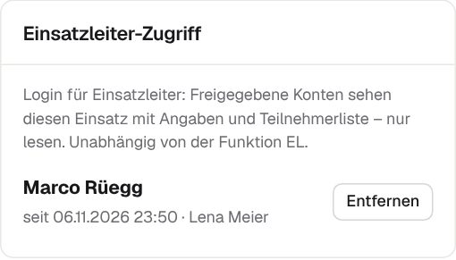

1. Den Einsatz öffnen, Reiter **Übersicht**.
2. Rechts in der Karte **Einsatzleiter-Zugriff** den Einsatzleiter wählen und **Freigeben** klicken. Ist bei «Einsatzleitung» eine Person eingetragen, die ein Einsatzleiter-Konto hat, ist sie schon vorausgewählt. Hat jemand mit einer Funktion (z. B. EL) ein Einsatzleiter-Konto, erscheint oben ein Vorschlag mit eigenem **Freigeben**-Knopf.
3. Der Einsatz erscheint sofort unter «Meine Einsätze» des Einsatzleiters.

Ein Einsatz kann für mehrere Einsatzleiter freigegeben sein. **Entfernen** nimmt die Freigabe wieder weg. Freigeben und Entfernen stehen im Verlauf des Einsatzes. Die Freigabe bleibt bestehen, bis sie jemand entfernt – auch nach dem Einsatz; die Essenseinschränkungen sind dann aber nicht mehr sichtbar. Wechselt das Konto in eine andere Rolle, verfallen seine Freigaben.

### Was Einsatzleiter sehen

Einsatzleiter melden sich gleich an wie alle anderen. Statt des Cockpits sehen sie **Meine Einsätze**: alle Einsätze, die für sie freigegeben sind, anstehende oben, vergangene darunter.

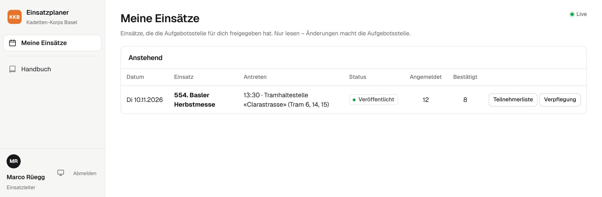

Ein Klick auf den Einsatz zeigt:

- **Angaben:** Datum, Antreten und Abtreten, Einsatzleitung, Tenue, Beschreibung.
- **Schichten** mit Zeiten und Besetzung (Ist / Soll), dazu die externen Abteilungen.
- **Funktionen** mit Ist / Soll pro Schicht und wer welche Funktion hat.
- **Teilnehmer** mit Funktion, Rang, Mobilnummer, Essenseinschränkungen, Schicht und Status, der tiefste Rang zuerst. Auswahl wie bei der Teilnehmerliste: «Angemeldete», «Nur bestätigte» oder «Angemeldete + Warteliste», einzelne Schicht, Sortierung.
- Oben **Teilnehmerliste (PDF)**, **Excel** und **CSV** – genau mit der gewählten Auswahl.

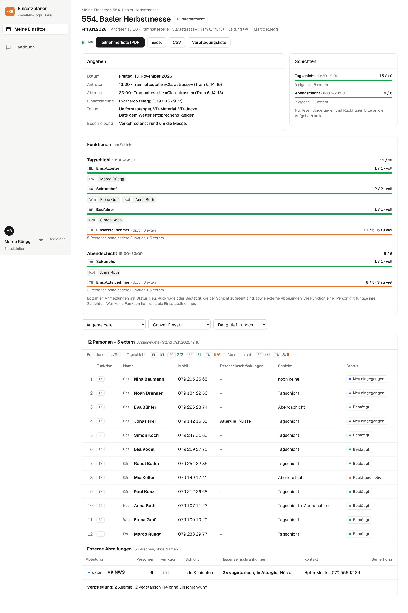

Einsatzleiter können nichts ändern und sehen keine anderen Einsätze, keine Personenliste, keine Rückmeldungen, Anfragen oder internen Bemerkungen. Änderungen und Rückfragen gehen an die Aufgebotsstelle. Die Essenseinschränkungen sind wie bei der Aufgebotsstelle nur bis zum Einsatz sichtbar, danach steht «Hinweis vorhanden». Jedes PDF und jeder Download steht im Verlauf des Einsatzes.

Unter «Handbuch» sehen Einsatzleiter nur ihr eigenes, kurzes [Handbuch für Einsatzleiter](/handbuch/einsatzleiter). Die Aufgebotsstelle findet es auf der Handbuch-Seite oben rechts.

## 16 · Das Aufgebot als Kalendertermin

Ist ein Einsatz besetzt, erstellt die Aufgebotsstelle das Aufgebot mit einem Klick auf **Kalendertermin**. Heraus kommt eine Kalenderdatei (.ics), die sich in Outlook, Google Kalender oder Apple Kalender öffnen und weiterleiten lässt.

1. Den Einsatz öffnen und oben auf **Kalendertermin** klicken.
2. Bei mehreren Schichten wählen: ein Termin für den ganzen Einsatz, ein Termin pro Schicht oder nur eine bestimmte Schicht.
3. Die Datei öffnen oder weiterleiten.

- **Termin von – bis** entspricht Antreten bis Abtreten.
- **Teilnehmende:** Alle **bestätigten** Personen mit E-Mail-Adresse werden als Kalender-Teilnehmende eingetragen.
- **Aktualisieren statt verdoppeln:** Ändert sich etwas und man exportiert erneut, aktualisiert der Kalender den bestehenden Termin.

### Die Vorlage mit Bausteinen (Admin)

Unter **Einstellungen › Kalendertermin** legt der Admin einmal fest, wie das Aufgebot aussieht: Titel, Ort, Zeit und Beschreibung aus Text und **Bausteinen** wie `{{einsatz.name}}`. Die Beschreibung lässt sich formatieren (siehe «Texte formatieren» unten). Bausteine werden rechts per Klick eingefügt und beim Export durch die Angaben des Einsatzes ersetzt. **Vorschau** zeigt das Ergebnis für einen echten Einsatz.

| Baustein | Beispiel |
|---|---|
| `{{einsatz.name}}` | 554. Basler Herbstmesse |
| `{{einsatz.datum_kurz}}` | 03.11. |
| `{{schicht.name}}` | Tagschicht |
| `{{antreten.datum}}` · `{{antreten.zeit}}` · `{{antreten.ort}}` | Dienstag, 3. November 2026 · 13:30 · Tramhaltestelle «Clarastrasse» |
| `{{abtreten.datum}}` · `{{abtreten.zeit}}` · `{{abtreten.ort}}` | wie Antreten, mit der Endzeit |
| `{{einsatzleitung}}` | Fw Marco Rüegg (079 …) |
| `{{einsatz.tenue}}` | Uniform (orange), VD-Material, VD-Jacke |
| `{{teilnehmende.liste}}` · `{{teilnehmende.anzahl}}` | Namen der Bestätigten · Anzahl |
| `{{verein.aufgebot_email}}` | aufgebot@kkb.ch |
| `{{absender}}` | Rang und Name der Person, die exportiert |
| `{{zusatzfeld.Name}}` | jedes Zusatzfeld eines Einsatzes, z. B. Transport |

Optionen: Zeilen mit leerem Baustein weglassen, Bestätigte als Teilnehmende eintragen, Erinnerung z. B. einen Tag vorher.

### Texte formatieren

Die Beschreibung des Kalendertermins und der Text der Bestätigungsmail lassen sich formatieren wie in Word oder Outlook. Über dem Textfeld steht dafür eine Werkzeugleiste:

| Knopf | Wirkung |
|---|---|
| **Absatz** | Normaler Text, Überschrift, Zwischentitel oder eingerückter Block |
| **Schriftart** · **Grösse** | z. B. Arial, Verdana, Georgia · Klein bis Riesig |
| **F** · *K* · U · ~~S~~ | Fett, Kursiv, Unterstrichen, Durchgestrichen (auch mit Strg+B, Strg+I, Strg+U) |
| **A** (Schriftfarbe) · **ab** (Hintergrund) | Farbe aus der Palette oder «Eigene Farbe»; «Keine Markierung» entfernt den Hintergrund |
| Aufzählung · Nummerierung · Einzug | Listen mit Punkten oder Zahlen, Einzug verkleinern oder vergrössern |
| Ausrichtung | Linksbündig, zentriert, rechtsbündig |
| Link | Webadresse oder E-Mail-Adresse verlinken (vorher Text markieren) |
| Tabelle | Grösse im Raster wählen, z. B. 3 × 2. Steht der Cursor in einer Tabelle, gibt es dort auch Zeilen und Spalten einfügen oder löschen, Rahmen ein/aus, Zellenfarbe und Tabelle löschen. Mit der Tab-Taste springt man in die nächste Zelle. |
| Trennlinie | Horizontale Linie |
| Formatierung entfernen · Rückgängig · Wiederholen | Markierten Text wieder schlicht machen, Schritte zurücknehmen |
| `<>` (ganz rechts) | HTML-Quelltext direkt bearbeiten – nur für Fortgeschrittene |

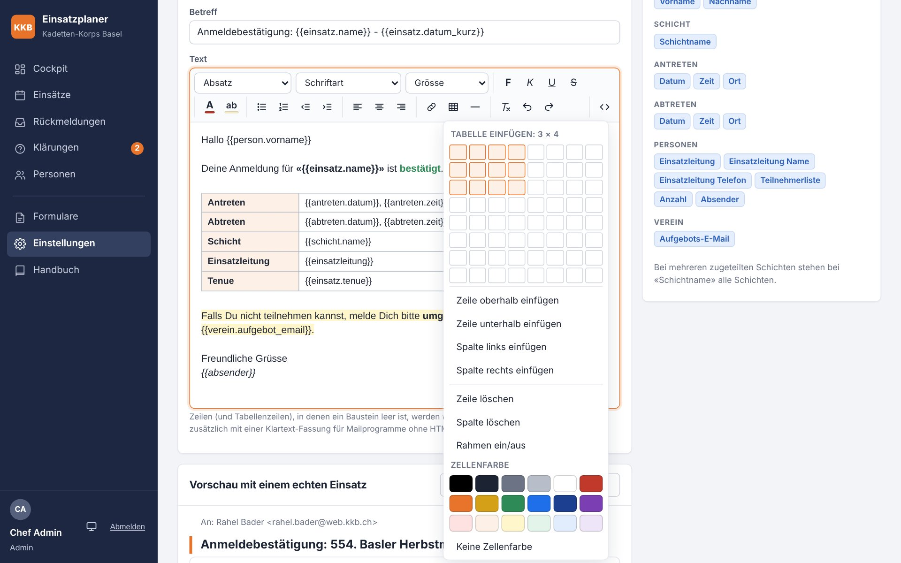

- **Bausteine** fügt man wie bisher rechts per Klick an der Cursorposition ein. Auch Bausteine lassen sich formatieren, z. B. `{{einsatz.name}}` fett.
- **Leere Bausteine:** Wie bisher fällt die Zeile weg, in der ein leerer Baustein steht. Steht er in einer Tabelle, fällt die ganze **Tabellenzeile** weg (z. B. «Tenue» bei Einsätzen ohne Tenue).
- **Einfügen aus Word oder Outlook** übernimmt die Formatierung, unnötiger Ballast wird entfernt. Bilder werden nicht übernommen.
- **Vorschau** zeigt den Text so, wie er beim Empfänger ankommt.

**Was beim Empfänger ankommt:**

- **Bestätigungsmail:** geht als formatierte Mail (HTML) raus und enthält zusätzlich eine Klartext-Fassung für Mailprogramme, die keine Formatierung anzeigen.
- **Kalendertermin:** Die Kalenderdatei enthält immer eine Klartext-Beschreibung und zusätzlich die formatierte Fassung. **Outlook** zeigt die Formatierung an, **Apple Kalender** nur den Klartext. Tabellen werden im Klartext zu Zeilen wie «Antreten | 13:30».
- Unter **Formatierung im Kalender** lässt sich umstellen auf **HTML direkt in der Beschreibung**. Das braucht es für Kalender, die nur die Beschreibung lesen, aber HTML darin anzeigen (z. B. **Google Kalender**, eventuell **ClubDesk**). Erscheinen nach dem Import Zeichen wie `
` im Termin, zurück auf **Normal** stellen.

> **Tipp:** Nach dem Umstellen einmal einen Kalendertermin exportieren und in ClubDesk bzw. Outlook importieren, um zu sehen, wie er dort aussieht.

## 17 · Personen und Stammdaten

Jede Person existiert genau einmal. Anmeldungen, Anfragen und Schichten verweisen nur auf sie.

- **Suche** nach Name, E-Mail oder Mobilnummer (auch Namensvarianten), Filter nach Mannschaft, Rang und Status, Sortierung nach Rang (tief → hoch oder hoch → tief) oder Name.
- **+ Neue Person** und **Bearbeiten** öffnen das Personenformular mit Rang, Mannschaften, Jahrgang, Mobil, E-Mail, Essenseinschränkungen und interner Bemerkung.
- **Namensvarianten** wie «Chrigi» werden bei der Person gespeichert und bei Anmeldungen automatisch erkannt.
- **Status setzen** für mehrere ausgewählte Personen (aktiv, inaktiv, ausgetreten). Inaktive erscheinen nirgends mehr als Vorschlag.
- **Löschen:** Unten im Personenformular lässt sich eine Person komplett löschen – mit allen ihren Anmeldungen und Anfragen. Vorher zeigt der Einsatzplaner, was alles betroffen ist. Für Ausgetretene ist «ausgetreten» meist die bessere Wahl.

### Import aus ClubDesk

Über **Import** lässt sich ein ClubDesk-Export (Excel oder CSV) einlesen. Zuerst kommt eine Vorschau mit Spaltenzuordnung, Dublettenprüfung und Fehlerliste – gespeichert wird erst nach der Bestätigung.

> **Sensible Angaben:** Essenseinschränkungen sieht vollständig nur der Admin; die Aufgebotsstelle sieht sie nur bei Personen, die für einen Einsatz angemeldet sind. Im Anmeldeformular werden solche Angaben nie abgefragt.

## 18 · Für Admins

Unter **Einstellungen** sorgt der Admin dafür, dass die Grundlagen stimmen.

### Benutzer

Konten anlegen, Rolle wählen (Admin, Aufgebotsstelle oder Einsatzleiter) und mit einer Person aus den Stammdaten verknüpfen – daraus kommen Rang und Name als «Absender» im Aufgebot. Die Liste zeigt auch, wer die Zwei-Faktor-Anmeldung eingerichtet hat.

- **Passwort zurücksetzen** erzeugt ein Startpasswort, meldet alle Sitzungen ab und verlangt beim nächsten Login ein eigenes Passwort.
- **Zwei-Faktor-Anmeldung:**
  - **Pflicht für dieses Konto:** Die Person muss die 2FA beim nächsten Login einrichten. Vorher kommt sie nirgends hin.
  - **Code verlangen:** bei jedem Login, oder einmal pro Tag, Woche, Monat bzw. 3 Monate pro Gerät. Gilt für alle, die 2FA eingerichtet haben – auch freiwillig.
  - **2FA zurücksetzen,** z. B. wenn jemand sein Handy verloren hat. Danach richtet die Person sie neu ein.
- **Microsoft-Anmeldung** (nur sichtbar, wenn sie auf dem Server eingerichtet ist, mehr in Kapitel 20): E-Mail-Adresse des Microsoft-Kontos eintragen und «Mit dem Microsoft-Konto dieser E-Mail-Adresse anmelden erlaubt» ankreuzen. Beim ersten Login wird das Konto fest mit diesem Microsoft-Konto verknüpft. Häkchen entfernen oder E-Mail ändern löst die Verknüpfung.
  - **Mit Benutzername und Passwort anmelden erlaubt:** Ausschalten heisst, dass die Person nur noch mit Microsoft hineinkommt. Mindestens eine Anmeldeart muss erlaubt bleiben. Das eigene Passwort-Login lässt sich erst abschalten, wenn man sich einmal erfolgreich mit Microsoft angemeldet hat.
  - **Notausgang:** Wird die Microsoft-Anmeldung ausgeschaltet (unter **Einstellungen › Server** nur «Passwort» ankreuzen), gilt das Passwort wieder für alle.
- **Rolle Einsatzleiter:** Das Konto sieht nur Einsätze, die die Aufgebotsstelle freigibt (Kapitel 15). Verknüpft man das Konto mit der Person aus den Stammdaten, wird es bei Einsätzen mit dieser Einsatzleitung zum Freigeben vorgeschlagen. Wechselt das Konto später in eine andere Rolle, verfallen seine Freigaben.
- **Konto aktiv** ausschalten sperrt den Zugang, ohne Daten zu löschen.
- **Benutzerkonto löschen** entfernt das Konto endgültig. Was die Person erfasst hat (Anmeldungen, Kontaktversuche, Verlauf), bleibt mit ihrem Namen erhalten, ebenso die verknüpfte Person in den Stammdaten. Das eigene Konto und den letzten aktiven Admin kann man nicht löschen.

### Auswahllisten und Vorlagen

**Ränge**, **Mannschaften / Kader**, **Externe Abteilungen** und **Funktionen an Einsätzen**. Die Reihenfolge der Ränge bestimmt die Sortierung: kleine Zahl = tiefer Rang, grosse Zahl = hoher Rang.

**Funktionen an Einsätzen** (EL, SC, BF, Einsatzteilnehmer) haben einen Namen und ein Kürzel. Die Reihenfolge bestimmt, in welcher Reihenfolge sie überall erscheinen (kleine Zahl = weiter oben, EL zuerst). Genau eine Funktion ist **Standard**: Wer keine Funktion zugewiesen hat, zählt als diese (Einsatzteilnehmer). Neue Funktionen, z. B. «Sanität · SAN», in der leeren Zeile ergänzen. Inaktive Funktionen werden beim Zuweisen nicht mehr angeboten. Die Spalte «Einsätze» zeigt, bei wie vielen Einsätzen eine Funktion verwendet wird; verwendete Funktionen und die Standard-Funktion lassen sich nicht entfernen.

Die Liste **Externe Abteilungen** füllt sich auch von selbst, wenn bei einem Einsatz ein neuer Name eingetippt wird. Hier lassen sich Namen korrigieren (die Änderung gilt dann für alle Einsätze), die Reihenfolge festlegen und Abteilungen deaktivieren: Inaktive werden bei Einsätzen nicht mehr vorgeschlagen. Die Spalte «Einsätze» zeigt, bei wie vielen Einsätzen eine Abteilung erfasst ist.

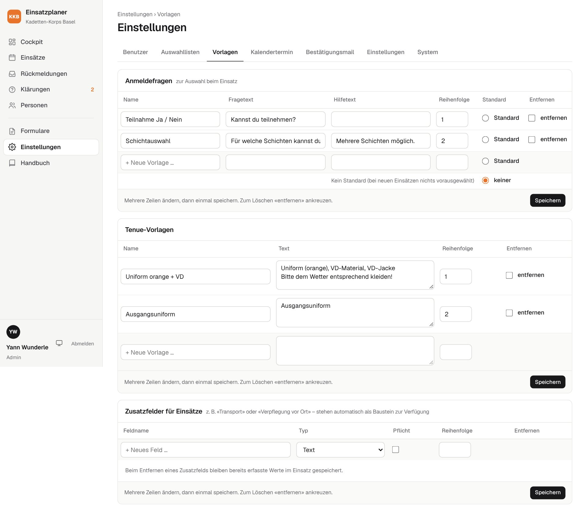

**Anmeldefragen**, **Tenue-Vorlagen** und **Zusatzfelder** für Einsätze (z. B. «Transport»). Jedes Zusatzfeld steht automatisch als Baustein zur Verfügung.

Bei den Anmeldefragen legt die Spalte **Standard** fest, welche Vorlage bei jedem neuen Einsatz schon vorausgewählt ist, samt Fragetext und Hilfetext. Mit «keiner» ist nichts vorausgewählt.

> **Speichern pro Abschnitt:** In Auswahllisten, Vorlagen und bei «Schichten verwalten» hat jeder Abschnitt einen einzigen Speichern-Knopf. Mehrere Zeilen ändern, in der leeren Zeile etwas Neues eintragen, bei anderen «entfernen» ankreuzen – und dann einmal speichern. Geänderte Zeilen sind links orange markiert. Ränge, Mannschaften oder externe Abteilungen, die noch verwendet werden, lassen sich nicht entfernen, nur deaktivieren.

### Bestätigungsmail

Betreff und Text der Anmeldebestätigung mit denselben Bausteinen wie im Kalendertermin. Der Text lässt sich formatieren – Schriftart, Grösse, Fett, Kursiv, Farben, Listen, Tabellen und Links (siehe «Texte formatieren» in Kapitel 16). Die Mail geht formatiert raus, mit einer Klartext-Fassung für Mailprogramme ohne HTML. Mit **Vorschau** für einen echten Einsatz prüfen und eine **Testmail** an sich selbst schicken. Der Haken «beim Bestätigen automatisch senden» schaltet den Versand ein oder aus. Ohne eingerichteten Mailserver bleiben die Mails im Postausgang (unter «Formulare») und gehen raus, sobald er eingerichtet ist.

### Einstellungen und Datensicherung

- **Verein:** Vereinsname und Aufgebots-E-Mail (steht im Aufgebot).
- **Anmeldeformular:** Titel, Einleitungstext und die Mindestzeit gegen Spam.
- **Datensicherung:** Die Datenbank wird täglich automatisch gesichert und 30 Tage aufbewahrt. **Jetzt sichern** erstellt sofort eine Sicherung. Ordner und Aufbewahrungsdauer stellst du unter **Server** ein.

### Server: die Werte aus der .env

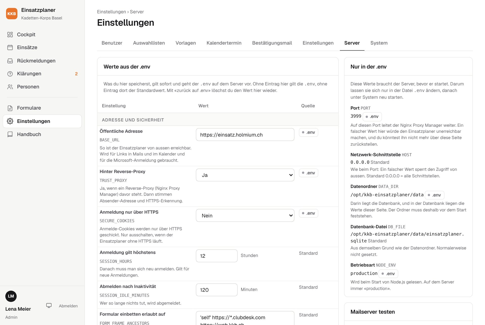

Die Grundeinstellungen des Servers standen früher nur in der Datei `.env` auf dem Server-PC. Fast alle lassen sich jetzt hier im Browser ändern:

- **Adresse und Sicherheit:** öffentliche Adresse (`https://einsatz.holmium.ch`), Reverse-Proxy, Anmeldung nur über HTTPS, wie lange eine Anmeldung gilt, Abmelden nach Inaktivität und die Webseiten, die das Anmeldeformular einbetten dürfen.
- **Anmeldung:** Passwort und/oder Microsoft und die Angaben der Microsoft-App (Kapitel 20).
- **E-Mail-Versand:** Mailserver, Port, SSL, Benutzername, Passwort und Absender. Mit **Mailserver testen** rechts eine Testmail an dich schicken.
- **Datensicherung:** Ordner und wie viele Tage die Sicherungen behalten werden.

So funktioniert es:

- Werte ändern und unten einmal **Speichern**. Sie gelten **sofort**, ein Neustart ist nicht nötig.
- Die Spalte **Quelle** zeigt, woher ein Wert kommt: **Verwaltung** (hier gespeichert), **.env** (aus der Datei auf dem Server) oder **Standard**. Was hier gespeichert ist, geht der `.env` vor.
- **Zurück auf .env** ankreuzen und speichern löscht den Wert hier wieder. Dann gilt wieder die `.env`.
- **Passwörter und Schlüssel** werden nie angezeigt. Das Feld bleibt leer, «gesetzt» heisst, dass es einen Wert gibt. Leer lassen = unverändert, etwas eintippen = neuer Wert.
- Jede Änderung wird mit Name und Zeit protokolliert, aber ohne die Werte selbst, also auch ohne Passwörter.

Damit sich niemand aussperrt, prüft die Seite beim Speichern: Die Passwort-Anmeldung lässt sich nur ausschalten, wenn die Microsoft-Angaben vollständig sind und dein eigenes Konto Microsoft freigegeben hat. «Anmeldung nur über HTTPS» lässt sich nur einschalten, wenn du gerade über HTTPS verbunden bist.

**Nur in der .env:** Port, Netzwerk-Schnittstelle, Datenordner, Datenbank-Datei und Betriebsart stehen rechts nur zum Ansehen. Der Server braucht sie, bevor er startet: Auf den Port leitet der Nginx Proxy Manager weiter, und im Datenordner liegt die Datenbank mit den Werten dieser Seite. Ein falscher Wert hier würde den Einsatzplaner unerreichbar machen, und man könnte ihn nicht mehr über den Browser zurückstellen. Diese Werte ändert man deshalb in der `.env` und startet danach unter **System** neu.

> **Ausgesperrt?** Auf dem Server-PC im Ordner `betrieb\windows` doppelt auf `server-zuruecksetzen.cmd` klicken. Das löscht alle Werte dieser Seite und startet den Einsatzplaner neu. Danach gilt wieder die `.env`. Nur einzelne Werte: Namen anhängen, z. B. `server-zuruecksetzen.cmd AUTH_PROVIDERS`.

Gut zu wissen: Die hier gespeicherten Passwörter liegen in der Datenbank und damit auch in jeder Datensicherung. Sicherungen deshalb genauso sorgfältig aufbewahren wie die `.env`.

### System: Update und Neustart

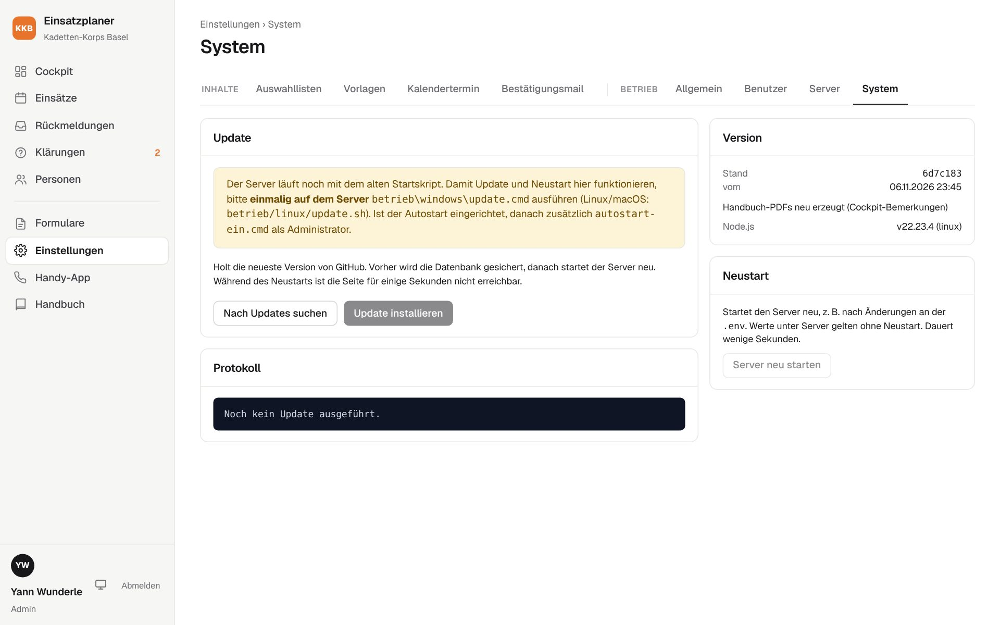

- **Nach Updates suchen** zeigt, ob es eine neue Version gibt.
- **Update installieren** sichert zuerst die Datenbank, holt dann die neue Version, installiert nötige Pakete und startet den Server neu. Das Protokoll läuft live mit. Während des Neustarts ist die Seite einige Sekunden nicht erreichbar.
- **Server neu starten**, z. B. nach Änderungen an der `.env`. Werte unter **Server** gelten ohne Neustart.
- **Version** zeigt Stand und Datum der installierten Version. Das Handbuch passt immer zu dieser Version.

### Formulare

- Offene Einsätze im Formular, Absendungen, Spamverdacht und Fehler auf einen Blick.
- **Formular-Eingang:** jede Absendung unverändert gespeichert – auch wenn eine Anmeldung später gelöscht wird.
- **Einbettung in ClubDesk:** die feste Adresse des Formulars. Sie wird einmal im ClubDesk-Baustein eingebettet, danach ist auf ClubDesk nie wieder etwas zu tun.
- **Postausgang:** versendete und wartende Anmeldebestätigungen.

## 19 · Sicherheit und Zwei-Faktor-Anmeldung

Mit der Zwei-Faktor-Anmeldung reicht das Passwort allein nicht mehr. Zusätzlich braucht es einen 6-stelligen Code, den nur das eigene Handy erzeugt. Wer das Passwort errät oder mitliest, kommt so trotzdem nicht hinein.

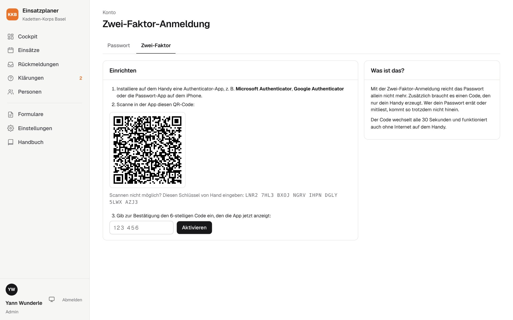

**Einrichten:**

1. Unten links auf den eigenen Namen klicken und den Reiter **Zwei-Faktor** öffnen.
2. Auf dem Handy eine Authenticator-App installieren, z. B. Microsoft Authenticator, Google Authenticator oder die Passwort-App auf dem iPhone.
3. In der App den **QR-Code scannen** (oder den Schlüssel von Hand eingeben).
4. Den aktuellen 6-stelligen Code eingeben und **Aktivieren**.
5. Die **10 Wiederherstellungscodes** aufschreiben oder ausdrucken und sicher aufbewahren. Jeder gilt genau einmal.

**Anmelden mit 2FA:** Nach dem Passwort den Code aus der App eingeben. Je nach Einstellung lässt sich «auf diesem Gerät nicht mehr fragen» ankreuzen – dann wird der Code auf diesem Gerät erst nach der eingestellten Zeit wieder verlangt.

**Handy verloren?** Mit einem Wiederherstellungscode anmelden (statt des 6-stelligen Codes eingeben) und die 2FA neu einrichten. Ohne Wiederherstellungscode setzt ein Admin die 2FA zurück.

Weitere Schutzmassnahmen: Passwörter mit mindestens 10 Zeichen, sicher verschlüsselt gespeichert; Sperre nach 5 Fehlversuchen für 15 Minuten; automatische Abmeldung nach Inaktivität; jede Änderung ist vor fremden Seiten geschützt.

## 20 · Microsoft-Anmeldung

Statt mit Benutzername und Passwort können sich Benutzer auch mit ihrem Microsoft-Konto anmelden, z. B. dem KKB-Konto von Microsoft 365. Wer hineindarf und mit welcher Rolle, bestimmt weiterhin der Einsatzplaner: Ein Microsoft-Konto allein öffnet nichts.

### Einmal einrichten

**1. App bei Microsoft registrieren**

1. Mit dem Microsoft-Konto auf **entra.microsoft.com** anmelden.
2. **Anwendungen › App-Registrierungen › Neue Registrierung**.
   - Name: `KKB-Einsatzplaner`
   - Unterstützte Kontotypen: **Nur Konten in diesem Organisationsverzeichnis**. Wird die App in einem eigenen Microsoft-Konto statt im Vereins-Konto registriert: **Konten in einem beliebigen Organisationsverzeichnis**.
   - Umleitungs-URI: Plattform **Web**, `https://einsatz.holmium.ch/auth/microsoft/callback`
3. **Registrieren**. Auf der Übersicht die **Anwendungs-ID (Client)** und die **Verzeichnis-ID (Mandant)** notieren.
4. **Zertifikate & Geheimnisse › Neuer geheimer Clientschlüssel**, Ablauf **24 Monate**. Sofort den **Wert** kopieren (nicht die «Geheimnis-ID»). Er wird nur einmal angezeigt. Das **Ablaufdatum** notieren.

**2. Einsatzplaner einstellen**

Unter **Einstellungen › Server**, Abschnitt «Anmeldung»:

1. Bei **Anmeldeverfahren** zusätzlich **Microsoft** ankreuzen.
2. **Tenant-ID:** die Verzeichnis-ID, bei «beliebiges Organisationsverzeichnis» `organizations`.
3. **Client-ID:** die Anwendungs-ID.
4. **Geheimer Schlüssel:** den kopierten Wert.
5. **Schlüssel läuft ab am:** das notierte Ablaufdatum.
6. **Speichern.** Ein Neustart ist nicht nötig.

Auf der Login-Seite erscheint jetzt **Mit Microsoft anmelden**. (Wer lieber direkt am Server arbeitet, kann dieselben Werte auch in der `.env` setzen: `AUTH_PROVIDERS=local,microsoft`, `MS_TENANT_ID`, `MS_CLIENT_ID`, `MS_CLIENT_SECRET`, `MS_SECRET_EXPIRES`, danach neu starten.)

**3. Benutzer freigeben**

Unter **Einstellungen › Benutzer › Bearbeiten**, Abschnitt «Anmeldung»:

1. Bei **E-Mail** die Adresse eintragen, mit der sich die Person bei Microsoft anmeldet.
2. **Mit dem Microsoft-Konto dieser E-Mail-Adresse anmelden erlaubt** ankreuzen und speichern.

Beim ersten Microsoft-Login wird das Benutzerkonto fest mit diesem Microsoft-Konto verknüpft. In der Benutzerliste steht dann «Passwort + Microsoft». Häkchen entfernen oder E-Mail ändern löst die Verknüpfung wieder.

### Nur noch Microsoft

- **Pro Person:** Häkchen **Mit Benutzername und Passwort anmelden erlaubt** entfernen. Die Person kommt dann nur noch mit Microsoft hinein. Das eigene Konto lässt sich erst umstellen, wenn man sich einmal erfolgreich mit Microsoft angemeldet hat.
- **Für alle:** unter **Einstellungen › Server** bei «Anmeldeverfahren» nur noch **Microsoft** ankreuzen und speichern. Die Login-Seite zeigt dann nur noch den Microsoft-Knopf. Das geht erst, wenn dein eigenes Konto die Microsoft-Anmeldung freigegeben hat.

Die Zwei-Faktor-Abfrage des Einsatzplaners gilt nur für das Passwort-Login. Bei Microsoft gilt die Anmeldesicherheit von Microsoft.

### Alle 24 Monate: Schlüssel erneuern

Der geheime Clientschlüssel bei Microsoft gilt höchstens 24 Monate. Läuft er ab, funktioniert **Mit Microsoft anmelden** nicht mehr. Ist das Ablaufdatum unter **Einstellungen › Server** eingetragen, zeigt das Cockpit allen Admins 30 Tage vorher eine Erinnerung.

So wird der Schlüssel erneuert, am besten ein paar Tage vor dem Ablauf:

1. Auf **entra.microsoft.com** anmelden, **Anwendungen › App-Registrierungen › KKB-Einsatzplaner** öffnen.
2. **Zertifikate & Geheimnisse › Neuer geheimer Clientschlüssel**, Ablauf **24 Monate**, **Hinzufügen**.
3. Sofort den **Wert** kopieren.
4. Unter **Einstellungen › Server** bei **Geheimer Schlüssel** den neuen Wert eintragen, bei **Schlüssel läuft ab am** das neue Datum, und speichern.
5. Abmelden und einmal mit Microsoft anmelden, um es zu prüfen.
6. Bei Microsoft den alten Schlüssel löschen (Papierkorb-Symbol in der Zeile).

Die Freigaben und Verknüpfungen der Benutzer bleiben dabei erhalten.

### Zurück zum Passwort-Login (Notausgang)

Unter **Einstellungen › Server** bei «Anmeldeverfahren» nur **Passwort** ankreuzen und speichern. Kommt niemand mehr hinein, auf dem Server-PC `betrieb\windows\server-zuruecksetzen.cmd` doppelklicken. Danach gilt wieder die `.env`, und dort steht normalerweise `AUTH_PROVIDERS=local`. Der Microsoft-Knopf verschwindet, und das Passwort gilt wieder für alle, auch für Konten mit «nur Microsoft». Das hilft auch, wenn Microsoft einmal nicht erreichbar ist oder der Schlüssel abgelaufen ist.

**Fehlermeldungen bei der Microsoft-Anmeldung:**

| Meldung | Bedeutung |
|---|---|
| «Kein Zugang freigegeben» | Für diese E-Mail ist beim Benutzerkonto keine Microsoft-Anmeldung freigegeben, oder die E-Mail stimmt nicht genau. |
| «Genehmigung erforderlich» (von Microsoft) | Die Organisation erlaubt die App nur mit Zustimmung eines Microsoft-Admins des Vereins. |
| «Microsoft-Anmeldung fehlgeschlagen» | Meist ist der Schlüssel abgelaufen oder falsch eingetragen. Siehe «Schlüssel erneuern». |

## 21 · Häufige Fragen

**Brauchen die Mitglieder ein Konto oder eine App?**
Nein. Sie öffnen das Formular auf der ClubDesk-Seite, geben Vor- und Nachnamen ein und wählen ihre Einsätze – auf jedem Handy und Computer.

**Was passiert, wenn sich jemand vertippt oder einen Spitznamen verwendet?**
Die Anmeldung geht nicht verloren. Sie landet in den Klärungen und wird dort mit wenigen Klicks zugeordnet. Mit «als Namensvariante speichern» klappt es beim nächsten Mal automatisch.

**Kann eine Anmeldung verloren gehen?**
Das Mitglied sieht die Bestätigungsseite erst, wenn die Anmeldung sicher gespeichert ist. Jede Absendung wird zusätzlich unverändert unter «Formulare» aufbewahrt, und die Daten werden täglich gesichert.

**Was ist, wenn jemand das Formular zweimal abschickt?**
Doppelte Absendungen werden erkannt. Pro Person und Einsatz gibt es höchstens eine Anmeldung.

**Ist man automatisch dabei, wenn man sich anmeldet?**
Nein. Jede Anmeldung wird von der Aufgebotsstelle bestätigt. Erst dann erhält das Mitglied seine Anmeldebestätigung.

**Was ist, wenn ein Einsatz voll ist?**
Das Cockpit weist darauf hin. Den Einsatz mit dem Schalter «Im Formular anzeigen» herausnehmen. Weitere Anmeldungen kommen auf die Warteliste.

**Ich habe einen Kontaktversuch bei der falschen Person erfasst.**
Im Reiter «Anfragen» beim letzten Kontaktversuch auf den Pfeil klicken. Er wird zurückgenommen, eine daraus erstellte Anmeldung ebenfalls.

**Jemand weiss noch nicht, ob er kommt.**
In den Rückmeldungen oder bei den Anfragen einen Kontaktversuch mit dem Ergebnis «Unsicher – weiss es noch nicht» erfassen. Er erscheint dann gelb mit «?» und bleibt ein offener Fall.

**Können mehrere Personen gleichzeitig arbeiten?**
Ja. Alle sehen live denselben Stand. Bearbeiten zwei Personen denselben Eintrag, zeigt der Einsatzplaner beide Stände an, und niemand überschreibt den anderen unbemerkt.

**Kann ich die Listen ausdrucken oder nach Excel exportieren?**
Ja. Jede Liste lässt sich drucken und als Excel- oder CSV-Datei exportieren, genau mit den eingestellten Filtern.

**Wie bekomme ich eine Liste aller Teilnehmenden mit Telefon und Essenswünschen?**
Im Einsatz oben auf **Teilnehmerliste** klicken – sie öffnet sich als PDF in einem neuen Tab. Excel, CSV und weitere Auswahl gibt es über den Pfeil daneben.

**Kann der Einsatzleiter selbst sehen, wer kommt?**
Ja. Er braucht ein Konto mit der Rolle «Einsatzleiter», und die Aufgebotsstelle gibt ihm den Einsatz in der Übersicht unter «Einsatzleiter-Zugriff» frei. Dann sieht er Angaben und Teilnehmerliste – nur lesen.

**Wie lege ich fest, wie viele EL, SC, BF und Einsatzteilnehmer es braucht?**
Einsatz **Bearbeiten** › Karte **Schichten und Soll** (pro Schicht eine Spalte). Zuweisen in der Übersicht (Karte «Funktionen») oder im Reiter «Anmeldungen» in der Spalte «Funktion». Wer nichts zugewiesen hat, ist Einsatzteilnehmer.

**Ist die Funktion EL dasselbe wie die Rolle «Einsatzleiter»?**
Nein. Die Funktion EL ist die Einteilung am Einsatz. Die Rolle «Einsatzleiter» ist ein Benutzerkonto mit Lesezugriff. Hat jemand beides, schlägt die Übersicht vor, ihm den Einsatz freizugeben.

**Eine andere Abteilung schickt Leute. Muss ich alle Namen erfassen?**
Nein. In der Übersicht des Einsatzes unter **Externe Abteilungen** nur die Abteilung und die Anzahl Personen eintragen, bei Bedarf auch Essenseinschränkungen als Anzahl (z. B. 2 × vegetarisch). Sie zählen in der Besetzung und in der Verpflegung mit und stehen auf der Teilnehmerliste.

**Funktioniert der Einsatzplaner auf dem Handy?**
Ja. Er ist für den Computer gemacht, lässt sich aber auch auf Tablet und Handy bedienen – etwa um unterwegs einen Anruf zu erfassen.

**Kann ich das Handbuch ausdrucken oder weiterschicken?**
Ja. Auf der Seite «Handbuch» oben rechts **Als PDF** klicken. Es öffnet sich das gestaltete Handbuch mit Titelseite, Inhaltsverzeichnis und Seitenzahlen in einem neuen Tab; von dort drucken, speichern oder weiterschicken. Das Handbuch für Einsatzleiter gibt es genauso als eigenes PDF.

**Woher weiss ich, ob dieses Handbuch aktuell ist?**
Oben auf der Handbuch-Seite stehen Stand und Version, im PDF steht der Stand auf der Titelseite. Das Handbuch und sein PDF werden mit jedem Update mitgeliefert und passen damit immer zur installierten Version.
