# KKB-Einsatzplaner – Handbuch

Anleitung für die Aufgebotsstelle und die Admins des Kadetten-Korps Basel. Das Handbuch gehört zur installierten Version: Mit jedem Update kommt automatisch der passende Stand mit.

> **Zu den Bildern:** Alle Namen, Zahlen und Telefonnummern in den Bildern sind frei erfunden.

## 1 · Warum ein Einsatzplaner?

Ein Einsatz mit rund 15 Kadettinnen und Kadetten bedeutet viel Kleinarbeit: Anmeldungen sammeln, Fehlende anrufen, Schichten füllen und am Schluss das Aufgebot schreiben. Der Einsatzplaner bündelt all das an einem Ort.

| Aufgabe | Bisher | Mit dem Einsatzplaner |
|---|---|---|
| Anmeldungen sammeln | Aus Formular, Telefon und WhatsApp von Hand zusammentragen | Landen automatisch beim richtigen Einsatz und bei der richtigen Person |
| Wer fehlt noch? | Listen gegeneinander abgleichen | «Rückmeldungen» zeigt für jedes Mitglied An, Ab, Unsicher oder Offen |
| Nachfassen | Steht im Kopf oder im Chatverlauf einer Person | Jeder Anruf und jede WhatsApp ist mit Datum und Absender erfasst – für alle sichtbar |
| Neuer Einsatz auf ClubDesk | Seite oder Formular anpassen | Nichts zu tun: Das Formular reiht neue Einsätze selbst ein |
| Aufgebot verschicken | Text für jeden Einsatz neu schreiben | Kalendertermin per Klick, Text aus unserer Vorlage |
| Zusammenarbeit | Jede Person hat einen anderen Stand | Alle sehen live denselben Stand, ohne neu zu laden |
| Nachvollziehbarkeit | Unklar, wer was wann geändert hat | Jede Änderung ist mit Person und Zeitpunkt protokolliert |

## 2 · Der Ablauf auf einen Blick

Jeder Einsatz durchläuft dieselben Schritte. Die Mitglieder sehen davon nur einen: das Anmeldeformular auf unserer ClubDesk-Seite.

1. **Einsatz anlegen** – Name und Datum genügen für den Anfang (Kapitel 5).
2. **Veröffentlichen** – der Einsatz erscheint sofort im Anmeldeformular.
3. **Mitglieder melden sich an** – über das Formular, mit Vor- und Nachname (Kapitel 6).
4. **Zuordnen** – der Einsatzplaner erkennt die Person. Was nicht eindeutig ist, landet in den Klärungen (Kapitel 8).
5. **Nachfassen** – wer sich nicht gemeldet hat, wird angerufen oder per WhatsApp angefragt (Kapitel 9).
6. **Bestätigen und Schichten besetzen** – jede Anmeldung wird von Hand bestätigt (Kapitel 7 und 10).
7. **Aufgebot** – der Kalendertermin mit allen Angaben entsteht per Klick (Kapitel 12).

> **Wichtig:** Niemand gilt automatisch als dabei, nur weil er das Formular ausgefüllt hat. Bestätigt wird immer von Hand durch die Aufgebotsstelle.

## 3 · Erste Schritte

Der Einsatzplaner läuft im Browser – auf dem Computer, dem Tablet oder dem Handy. Es muss nichts installiert werden.

### Anmelden

1. Die Adresse des Einsatzplaners öffnen (z. B. einsatz.holmium.ch) und ein Lesezeichen setzen.
2. Mit dem persönlichen Benutzernamen und Passwort anmelden. Jede Person hat ein eigenes Konto – Konten werden nicht geteilt.
3. Ist die **Zwei-Faktor-Anmeldung** eingerichtet, fragt der Einsatzplaner danach nach dem 6-stelligen Code aus der Authenticator-App (Kapitel 15).
4. Es öffnet sich das Cockpit.

Nach 5 falschen Versuchen (Passwort oder Code) ist das Konto für 15 Minuten gesperrt. Ein vergessenes Passwort setzt ein Admin zurück.

### Wer darf was?

| Rolle | Was diese Rolle kann |
|---|---|
| Aufgebotsstelle | Einsätze und Schichten anlegen und veröffentlichen, Anmeldungen prüfen, zuordnen und bestätigen, Anfragen erfassen, Schichten besetzen, Kalendertermine exportieren, drucken und exportieren, Personen pflegen |
| Admin | Alles, was die Aufgebotsstelle kann, und zusätzlich: Benutzer verwalten, Auswahllisten, Vorlagen, Bestätigungsmail und Einstellungen, Formular-Eingänge, Update und Neustart, Änderungen an abgeschlossenen Einsätzen (mit Begründung) |
| Mitglieder | Haben kein Konto. Sie melden sich nur über das Anmeldeformular auf ClubDesk an |

### Aufbau der Oberfläche

Links steht die Navigation, rechts der Inhalt.

| Bereich | Wofür |
|---|---|
| Cockpit | Startseite: was heute zu tun ist |
| Einsätze | Alle Einsätze; pro Einsatz die Reiter Übersicht, Anmeldungen, Anfragen, Schichten, Formular und Verlauf |
| Rückmeldungen | Wer hat sich wofür gemeldet – als Tabelle oder pro Einsatz |
| Klärungen | Anmeldungen, deren Name nicht sicher zugeordnet werden konnte. Die Zahl zeigt, wie viele offen sind |
| Personen | Stammdaten mit Suche; pro Person eine eigene Seite |
| Formulare | Eingänge des Anmeldeformulars, Fehler und Postausgang (Admin) |
| Einstellungen | Benutzer, Auswahllisten, Vorlagen, Kalendertermin, Bestätigungsmail, Einstellungen, System (Admin) |
| Handbuch | Diese Anleitung, immer im Stand der installierten Version |

### Bedienung, die überall gleich ist

- **Live:** Die grüne Anzeige «Live» oben bedeutet, dass sich die Seite von selbst aktualisiert, wenn jemand anderes etwas ändert. Während man selbst etwas eingibt, wartet die Aktualisierung und zeigt stattdessen «Es gibt neue Daten».
- **Suchen beim Tippen:** Alle Suchfelder filtern sofort, Enter ist nicht nötig. Auswahlfelder wie Mannschaft oder Status wirken ebenfalls sofort.
- **Auswahlfelder mit Suche:** Wo man eine Person oder einen Einsatz auswählt, kann man einfach tippen, z. B. «meier chr». Gross-/Kleinschreibung, Umlaute und die Reihenfolge der Wörter spielen keine Rolle.
- **Sortierung nach Rang:** Personenlisten sind standardmässig vom höchsten zum tiefsten Rang sortiert, bei gleichem Rang nach Name. Im Auswahlfeld «Sortierung» lässt sich auf «Rang: tief → hoch» umschalten.
- **Die Stelle bleibt:** Nach dem Speichern kommt man an dieselbe Stelle der Seite zurück.
- **Nichts geht verloren:** Hat ein anderer Teil der Seite noch ungespeicherte Eingaben, fragt der Einsatzplaner vor dem Speichern nach. Beim Verlassen einer Seite mit ungespeicherten Eingaben warnt der Browser.
- **Gleichzeitig bearbeiten:** Bearbeitet jemand denselben Eintrag, steht oben ein Hinweis. Speichern zwei Personen gleichzeitig, zeigt der Einsatzplaner beide Stände an, statt still zu überschreiben.
- **Export und Drucken:** Listen lassen sich als Excel oder CSV exportieren – genau mit den eingestellten Filtern – und drucken. Ausdrucke sind immer hell.
- **Die Suche oben rechts** findet Personen, Einsätze und Anmeldungen.

### Konto und Darstellung

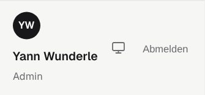

- Ein Klick auf den **eigenen Namen** öffnet das Konto: Passwort ändern und Zwei-Faktor-Anmeldung einrichten.
- Das **Symbol daneben** wechselt die Darstellung: «wie System» (Bildschirm), «Hell» (Sonne) oder «Dunkel» (Mond). Die Wahl gilt pro Benutzer auf allen Geräten.

## 4 · Das Cockpit

Das Cockpit beantwortet jeden Tag die Frage: Was ist zu tun?

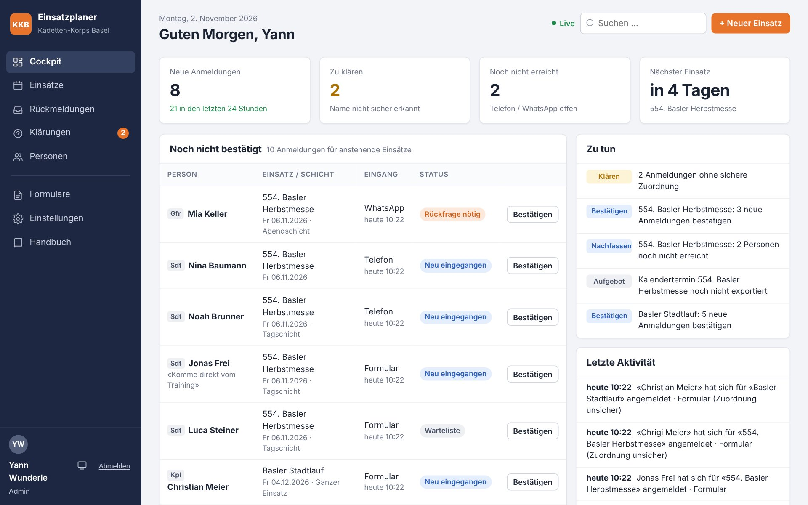

- **Kennzahlen:** neue Anmeldungen, unklare Namen, noch nicht erreichte Personen und die Tage bis zum nächsten Einsatz.
- **Anstehende Einsätze:** Besetzung pro Schicht (Ist / Soll; grün = voll, gelb = teilweise, rot = viele fehlen), dazu wie viele Anmeldungen neu, unsicher oder offen sind. Ein Klick öffnet den Einsatz.
- **Zu tun:** konkrete Hinweise, z. B. Anmeldungen bestätigen, Personen nachfassen, ein voller Einsatz, der noch im Formular steht, oder ein Aufgebot, das noch nicht exportiert ist.
- **Letzte Aktivität:** wer sich wann angemeldet hat, wer wen angefragt und wer was bestätigt hat.

## 5 · Einen Einsatz anlegen und veröffentlichen

### Die Einsatzliste

Die Liste zeigt alle Einsätze mit Datum, Antreten, Status, Besetzung und Einsatzleitung. Oben lässt sich nach Status, Zeitraum und Name filtern.

### Neuer Einsatz

Über **+ Neuer Einsatz** öffnet sich das Formular. Nur Name und Datum sind Pflicht – alles andere darf später ergänzt werden.

- **Grunddaten:** Name, Datum, Beginn (Antreten) und Ende (Abtreten), Antretens- und Abtretensort. Bleibt der Abtretensort leer, gilt der Antretensort.
- **Einsatzleitung:** aus den Personen wählen (tippen zum Suchen). Rang und Telefonnummer kommen so automatisch ins Aufgebot.
- **Tenue:** mit einem Klick eine Vorlage übernehmen, z. B. «Uniform orange + VD», und bei Bedarf anpassen.
- **Beschreibung** ist für die Mitglieder im Formular sichtbar, die **interne Bemerkung** nur für die Aufgebotsstelle.
- **Schichten:** Eine Schicht für den ganzen Einsatz wird automatisch angelegt, hier mit der Soll-Anzahl. Weitere Schichten kommen nach dem Speichern dazu.
- **Anmeldeformular:** Anmeldefrage aus einer Vorlage wählen und Text und Hilfetext anpassen.
- **Als Entwurf speichern** oder direkt **Veröffentlichen** – dann erscheint der Einsatz sofort im Anmeldeformular.

### Die Übersicht eines Einsatzes

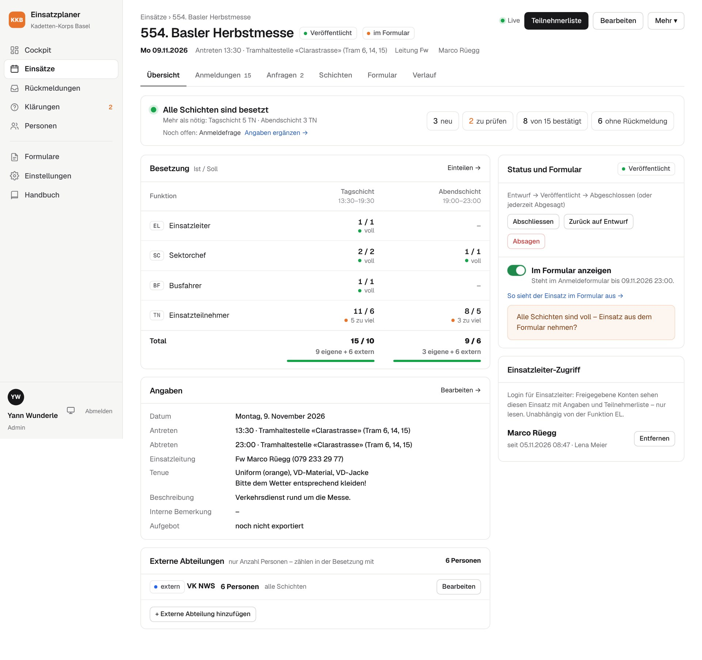

- **Kennzahlen:** neu eingegangen, zu prüfen, bestätigt und ohne Rückmeldung.
- **Besetzung** pro Schicht mit Ist / Soll.
- **Angaben** des Einsatzes und wann das Aufgebot zuletzt exportiert wurde.
- **Status:** Entwurf → Veröffentlicht → Abgeschlossen, oder jederzeit Abgesagt. Nach dem Abschluss sind die Daten schreibgeschützt; Änderungen sind dann nur noch durch einen Admin mit Begründung möglich. Bei einer Absage bleiben alle Daten erhalten.
- **Im Formular anzeigen:** schaltet den Einsatz im Anmeldeformular ein oder aus, z. B. wenn er voll ist.
- **Checkliste:** zeigt, welche Angaben noch fehlen.
- Oben gibt es **Kalendertermin**, **Drucken** bzw. **Export** und **Bearbeiten**.

### Reiter «Formular»

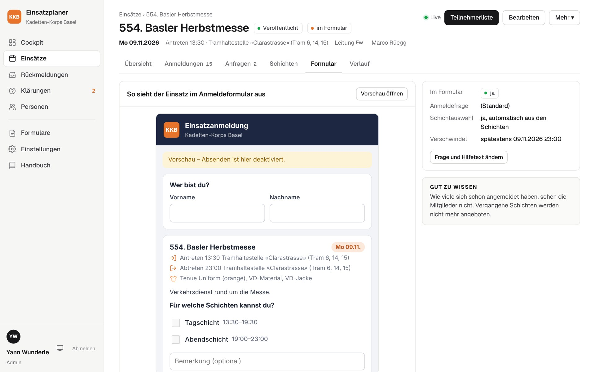

Zeigt genau, wie der Einsatz im Anmeldeformular aussieht, und bis wann er dort steht. «Vorschau öffnen» zeigt das ganze Formular in einem neuen Fenster; Absenden ist in der Vorschau deaktiviert.

### Reiter «Verlauf»

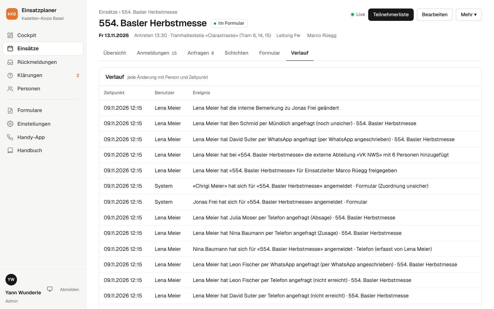

Jede Änderung am Einsatz, an Anmeldungen und Anfragen steht hier mit Zeitpunkt und Person.

## 6 · So melden sich die Mitglieder an

Es gibt ein einziges, gemeinsames Anmeldeformular für alle Einsätze. Es ist einmal auf der ClubDesk-Seite eingebettet und zeigt immer genau die Einsätze, für die man sich gerade anmelden kann.

- **Vor- und Nachname** – mehr braucht es nicht. Ein Konto ist nicht nötig.
- Pro Einsatz stehen Datum, **Antreten** und **Abtreten** (jeweils Zeit und Ort) sowie das **Tenue**.
- **Mehrere Schichten:** die gewünschten Schichten ankreuzen.
- **Eine Schicht:** «Ja, ich bin dabei» antippen. Wer nicht kann, lässt den Einsatz einfach leer.
- Eine **Bemerkung** ist pro Einsatz möglich.
- Man kann sich in einem Durchgang für mehrere Einsätze anmelden.

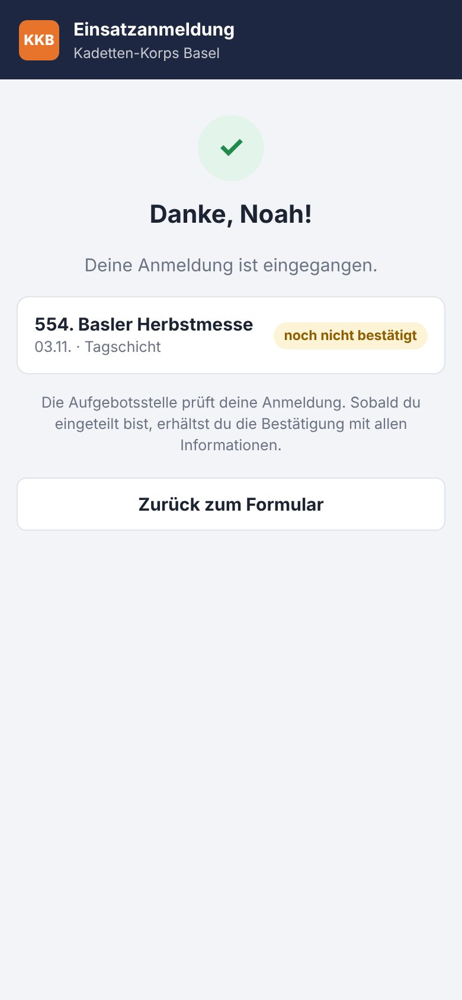

Die Bestätigungsseite erscheint erst, wenn die Anmeldung sicher gespeichert ist, und weist darauf hin, dass sie noch nicht bestätigt ist.

### Wann ein Einsatz im Formular steht

| Situation | Was passiert |
|---|---|
| Einsatz wird veröffentlicht | Er erscheint sofort im Formular. Auf ClubDesk ist nichts zu tun |
| Einsatz ist voll oder abgesagt | Die Aufgebotsstelle nimmt ihn mit dem Schalter «Im Formular anzeigen» heraus. Das Cockpit erinnert daran |
| Letzte Schicht ist vorbei | Der Einsatz verschwindet automatisch aus dem Formular |
| Einzelne Schicht ist vorbei | Diese Schicht wird nicht mehr angeboten |

> **Gut zu wissen:** Wie viele sich schon angemeldet haben, sehen die Mitglieder nicht. Doppelt abgeschickte Formulare werden erkannt, und Spam wird über ein verstecktes Feld und eine Mindestzeit abgefangen.

## 7 · Anmeldungen bearbeiten und bestätigen

Jede Anmeldung landet automatisch beim richtigen Einsatz – egal ob sie über das Formular, per Telefon oder per WhatsApp kam.

- **Zähler pro Status** oben: ein Klick filtert die Liste.
- **Sortierung:** «Rang: hoch → tief» (Standard), «Rang: tief → hoch» oder «neueste zuerst». Daneben das Suchfeld.
- **Sammelaktionen:** mehrere Anmeldungen ankreuzen und gemeinsam bestätigen, den Status ändern oder exportieren.
- **Bestätigen** direkt in der Zeile. Orange markierte Zeilen sind noch nicht bestätigt.
- Bemerkungen der Mitglieder und Hinweise zur Verpflegung stehen in der Spalte «Bemerkung».

### Das Menü «…» einer Anmeldung

- Status setzen: Rückfrage nötig, Warteliste, Bestätigt, Zurückgezogen, Abgesagt.
- **Interne Bemerkung** festhalten.
- **Andere Person zuordnen**, falls die Zuordnung falsch war.
- **Als ungültig markieren**, z. B. bei einer Spass-Anmeldung.
- **Löschen (zurücksetzen):** entfernt die Anmeldung ganz, als wäre sie nie eingegangen. Eine daraus entstandene Anfrage wird wieder «offen». Der ursprüngliche Formular-Eingang bleibt unter «Formulare» erhalten.

### Anmeldung von Hand erfassen

Mit **+ Anmeldung erfassen** lässt sich eine Anmeldung per Telefon, WhatsApp oder mündlich eintragen. Im Feld «Person» einfach den Namen tippen.

### Die Status einer Anmeldung

| Status | Bedeutung | Zählt zur Besetzung |
|---|---|---|
| Neu eingegangen | Formular abgeschickt oder Zusage erfasst, noch nicht bearbeitet | ja |
| Unsichere Zuordnung | Name konnte nicht sicher zugeordnet werden (Kapitel 8) | nein |
| Rückfrage nötig | Es gibt noch etwas zu klären, z. B. «erst ab 19:30» | ja |
| Warteliste | Gültig, aber die Schichten sind voll | nein |
| Bestätigt | Teilnahme verbindlich bestätigt | ja |
| Zurückgezogen | Hat sich wieder abgemeldet | nein |
| Abgesagt | Hat abgesagt | nein |
| Ungültig | z. B. Test- oder Spass-Anmeldung | nein |

> **Nach dem Bestätigen** erhält das Mitglied automatisch eine Anmeldebestätigung per E-Mail, sofern eine Adresse hinterlegt ist und die Bestätigungsmail eingeschaltet ist (Kapitel 14).

## 8 · Unklare Namen zuordnen

Der Einsatzplaner ordnet einen Namen nur dann automatisch zu, wenn er eindeutig ist. Alles andere landet in den **Klärungen** – nichts wird geraten, und es werden nie selbständig neue Personen angelegt.

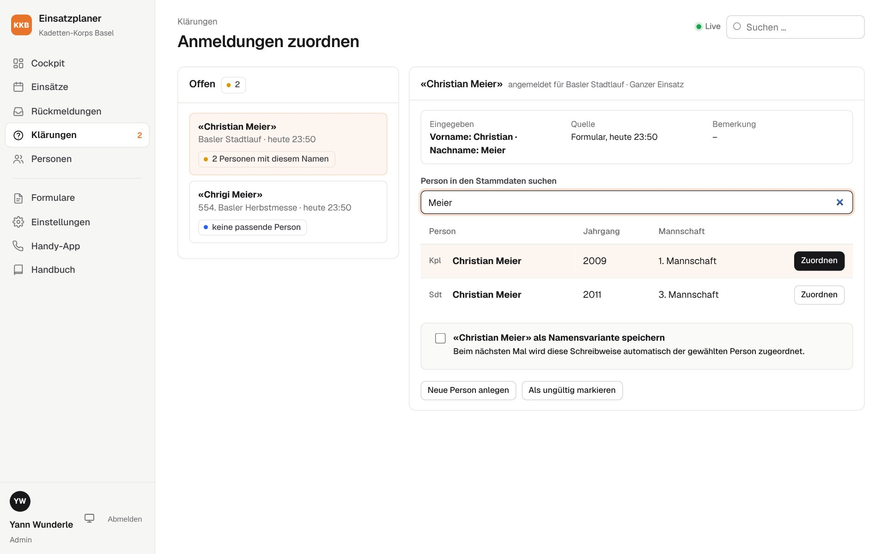

- **Mehrdeutig:** Es gibt zwei Personen mit demselben Namen, z. B. zweimal «Christian Meier».
- **Unbekannt:** Der Name passt zu niemandem, z. B. ein Spitzname wie «Chrigi Meier».

So geht's:

1. Links die offene Klärung wählen. Eingegebener Name, Quelle und Bemerkung stehen oben.
2. Im Suchfeld die Person suchen (die Liste filtert beim Tippen). Jahrgang und Mannschaft helfen bei gleichen Namen.
3. **Zuordnen** klicken. Mit **«… als Namensvariante speichern»** wird diese Schreibweise beim nächsten Mal automatisch erkannt.
4. Gibt es die Person noch nicht: **Neue Person anlegen**. Unsinn: **Als ungültig markieren**.

Gross- und Kleinschreibung, Leerzeichen, Umlaute (ä/ae) und vertauschte Vor- und Nachnamen erkennt der Einsatzplaner selbst.

## 9 · Nachfassen per Telefon und WhatsApp

Der Reiter **Anfragen** zeigt alle aktiven Mitglieder, die sich für diesen Einsatz noch nicht gemeldet haben, und alle, die schon angefragt wurden. Die Zahl im Reiter zeigt die offenen Nachfass-Fälle.

- **Zähler pro Status** oben filtern die Liste mit einem Klick. Daneben Mannschaft, Sortierung nach Rang und Namenssuche.
- Die **Mobilnummer** ist ein Anruf-Link; das Sprechblasen-Symbol daneben öffnet direkt den **WhatsApp-Chat**.
- **Kontaktversuche** stehen mit Kanal (Tel / WA), Datum, Uhrzeit, wer es war, Ergebnis und Notiz.
- **Erfassen** öffnet das Fenster für einen neuen Kontaktversuch.
- **Zugesagt / Abgesagt** direkt in der Zeile, wenn die Antwort nach einem Anruf oder einer WhatsApp kommt.
- Der **Pfeil** beim letzten Kontaktversuch nimmt ihn zurück, falls er falsch erfasst wurde. Hat er eine Anmeldung erzeugt, wird diese mitgelöscht.
- **Mehrere auf einmal:** Personen ankreuzen und **Kontakt für Ausgewählte erfassen**, z. B. «WhatsApp an alle gesendet». **Zur Anfrage vormerken** merkt Personen vor, ohne einen Kontakt zu erfassen.

Im Fenster wählt man Kanal, Datum und Uhrzeit (vorausgefüllt mit jetzt), **Gesendet von** (vorausgefüllt mit dem eigenen Namen, änderbar), das Ergebnis und eine Notiz.

### Das Ergebnis einer Anfrage

| Status | Bedeutung | Was danach passiert |
|---|---|---|
| Offen | Noch nicht kontaktiert | – |
| Vorgemerkt | Zur Anfrage vorgemerkt, noch kein Kontakt | – |
| Nicht erreicht | Telefonisch nicht erreicht | Bleibt oben in der Liste zum Nachfassen |
| Per WhatsApp angefragt | Nachricht gesendet, Antwort offen | Kommt die Antwort, «Zugesagt» oder «Abgesagt» klicken |
| Unsicher | «Weiss es noch nicht» | Bleibt ein offener Fall, bis die Antwort kommt |
| Zugesagt | Am Telefon oder per WhatsApp zugesagt | Es wird automatisch eine Anmeldung mit Quelle Telefon bzw. WhatsApp erstellt |
| Abgesagt | Kommt nicht | Wird für diesen Einsatz nicht mehr vorgeschlagen |
| Selbst gemeldet | Hat sich inzwischen selbst angemeldet | Erledigt, steht am Schluss der Liste |

> **Beispiel:** David Suter wurde am 26.10. und am 27.10. von Lena Meier angerufen, beide Male ohne Erfolg. Am Abend schreibt Anna Roth ihm per WhatsApp und erfasst das. Am nächsten Tag sieht die ganze Aufgebotsstelle, dass er schon zweimal angerufen und einmal angeschrieben wurde – niemand ruft ihn ein drittes Mal an.

## 10 · Schichten besetzen

Die meisten Einsätze haben nur eine Schicht für alle. Dann gibt es nichts zu verteilen: Jede Anmeldung gilt automatisch für diese Schicht.

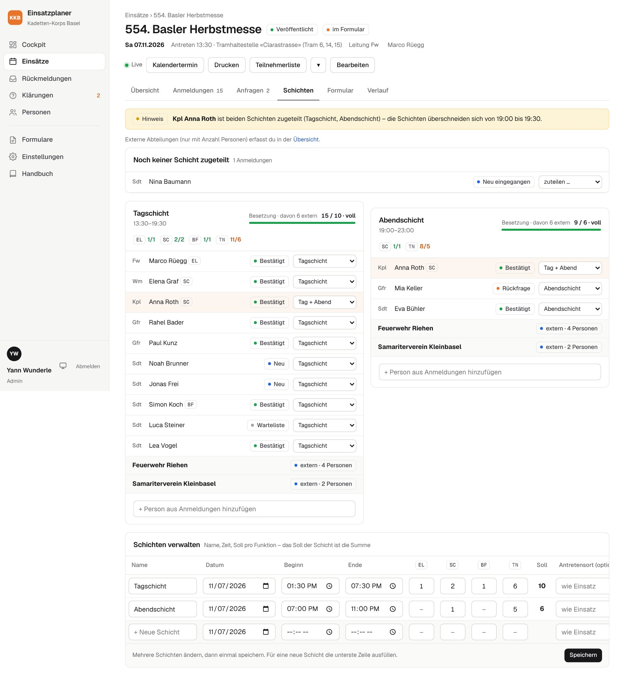

- Jede Schicht ist eine Spalte mit Zeit und Besetzung (Ist / Soll). Grün heisst voll.
- **Noch keiner Schicht zugeteilt:** Anmeldungen ohne Schicht stehen oben und werden über «zuteilen …» eingeteilt.
- **Umteilen** über das Auswahlfeld bei der Person. Eine Person kann auch mehreren Schichten zugeteilt sein («Tag + Abend»).
- **+ Person aus Anmeldungen hinzufügen:** Name tippen und auswählen.
- **Überschneidung:** Ist jemand zwei Schichten zugeteilt, die sich zeitlich überlappen, erscheint oben ein Hinweis. Er blockiert nichts.
- Die Schichtwünsche aus dem Formular sind schon übernommen. Meldet sich eine eingeteilte Person ab, wird die Besetzung sofort angepasst.

## 11 · Rückmeldungen und Mitgliederseite

Die Seite **Rückmeldungen** beantwortet die wichtigste Frage der Aufgebotsstelle: Wer hat sich für welchen Einsatz gemeldet – und wer noch nicht?

### Ansicht «Tabelle»

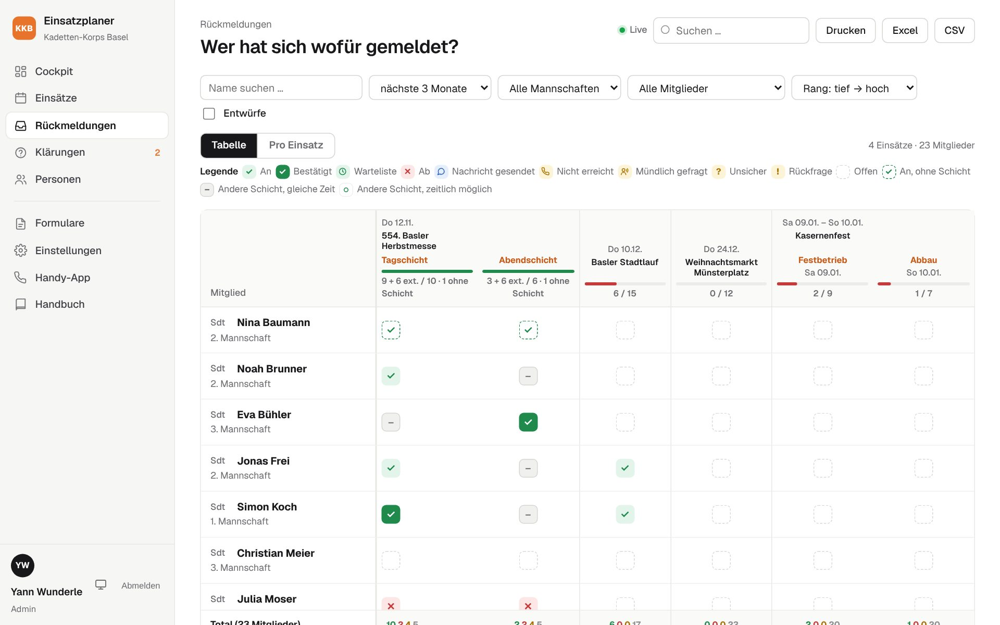

- Mitglieder als Zeilen, Einsätze als Spalten. Kopfzeile und Namensspalte bleiben beim Scrollen stehen.
- Im Spaltenkopf jedes Einsatzes steht die Besetzung als Balken, z. B. «11 / 16».
- **Symbole:** ✓ An, ✕ Ab, ? Unsicher, leeres Feld = Offen.
- Ein Klick auf eine Anmeldung öffnet sie; ein Klick auf ein leeres oder unsicheres Feld öffnet das Fenster für einen Kontaktversuch – dort lässt sich auch **«Unsicher – weiss es noch nicht»** eintragen.
- Unten stehen pro Einsatz die Summen An · Ab · Unsicher · Offen.

### Ansicht «Pro Einsatz»

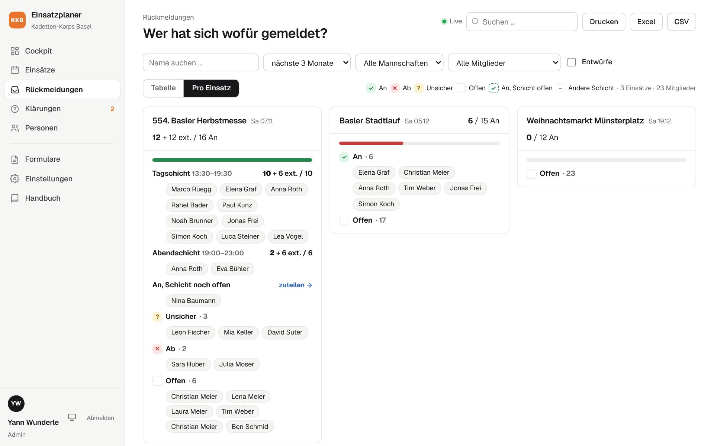

Eine Karte pro Einsatz mit den Namen, gruppiert nach An, Unsicher, Ab und Offen. Ein Klick auf einen offenen Namen erfasst direkt eine Anfrage. Diese Ansicht ist besonders übersichtlich, wenn viele Einsätze anstehen.

### Filter

Namenssuche, Zeitraum (nächste 2 Wochen bis nächstes Jahr), Mannschaft, «Nur mit offenen Einsätzen» oder «Nur mit Unsicheren», Sortierung (Rang hoch → tief oder tief → hoch, nach Name, meiste offen zuerst) und «Entwürfe» einblenden.

| Anzeige | Bedeutung |
|---|---|
| An | Angemeldet – über das Formular, telefonisch oder per WhatsApp |
| Ab | Abgesagt oder wieder abgemeldet |
| Unsicher | Nicht erreicht, WhatsApp ohne Antwort, «weiss es noch nicht» oder Anmeldung mit offener Frage |
| Offen | Noch keine Rückmeldung und noch nicht angefragt |

### Die Seite eines Mitglieds

- Links die wichtigsten **Stammdaten**.
- Die Einsätze nach **Angemeldet, Abgemeldet, Unsicher und Offen**, jeweils mit Datum und wie die Rückmeldung kam.
- Offene Einsätze lassen sich direkt mit **Anfrage erfassen** nachfassen.
- **Frühere Einsätze** und der **Verlauf** sind zuklappbar. Die Seite lässt sich drucken und nach Excel exportieren.

## 12 · Das Aufgebot als Kalendertermin

Ist ein Einsatz besetzt, erstellt die Aufgebotsstelle das Aufgebot mit einem Klick auf **Kalendertermin**. Heraus kommt eine Kalenderdatei (.ics), die sich in Outlook, Google Kalender oder Apple Kalender öffnen und weiterleiten lässt.

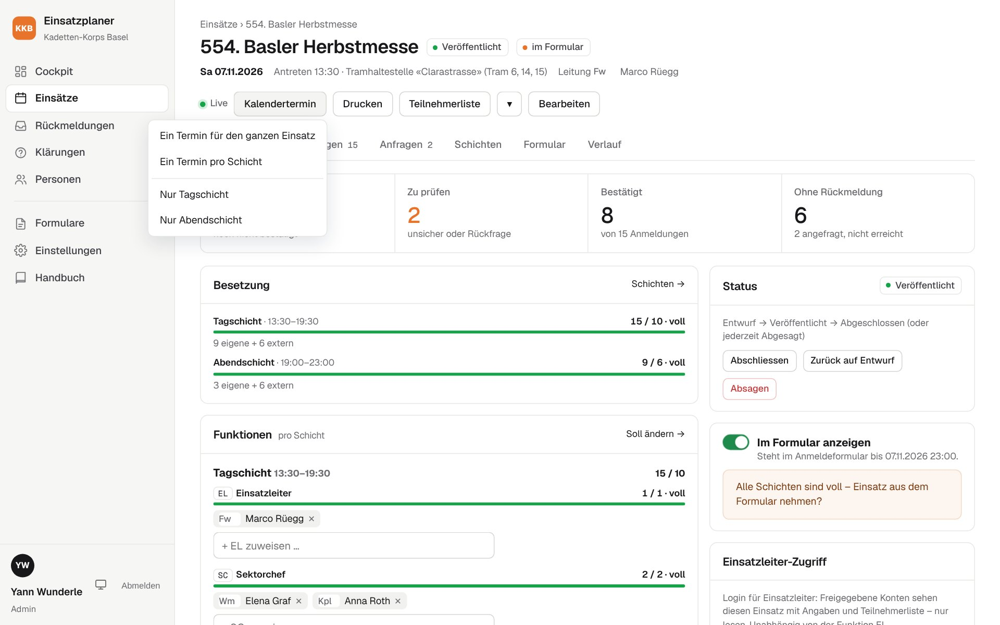

1. Den Einsatz öffnen und oben auf **Kalendertermin** klicken.
2. Bei mehreren Schichten wählen: ein Termin für den ganzen Einsatz, ein Termin pro Schicht oder nur eine bestimmte Schicht.
3. Die Datei öffnen oder weiterleiten.

- **Termin von – bis** entspricht Antreten bis Abtreten.
- **Teilnehmende:** Alle **bestätigten** Personen mit E-Mail-Adresse werden als Kalender-Teilnehmende eingetragen.
- **Aktualisieren statt verdoppeln:** Ändert sich etwas und man exportiert erneut, aktualisiert der Kalender den bestehenden Termin.

### Die Vorlage mit Bausteinen (Admin)

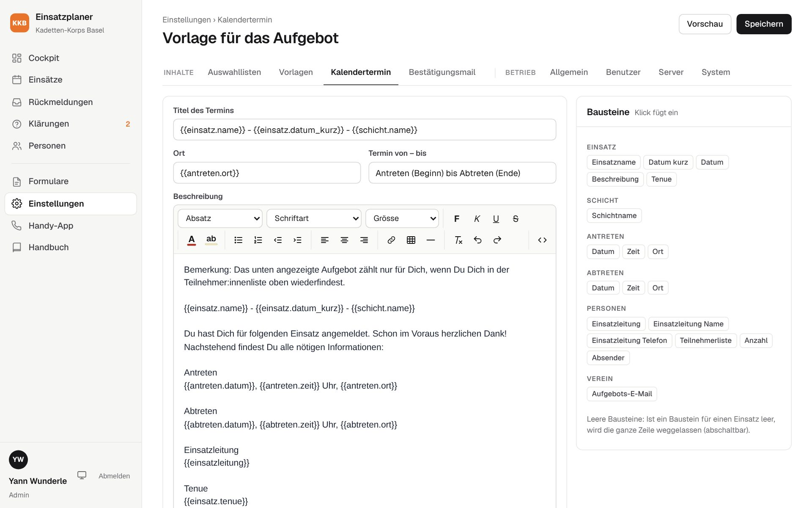

Unter **Einstellungen › Kalendertermin** legt der Admin einmal fest, wie das Aufgebot aussieht: Titel, Ort, Zeit und Beschreibung aus normalem Text und **Bausteinen** wie `{{einsatz.name}}`. Bausteine werden rechts per Klick eingefügt und beim Export durch die Angaben des Einsatzes ersetzt. **Vorschau** zeigt das Ergebnis für einen echten Einsatz.

| Baustein | Beispiel |
|---|---|
| `{{einsatz.name}}` | 554. Basler Herbstmesse |
| `{{einsatz.datum_kurz}}` | 03.11. |
| `{{schicht.name}}` | Tagschicht |
| `{{antreten.datum}}` · `{{antreten.zeit}}` · `{{antreten.ort}}` | Dienstag, 3. November 2026 · 13:30 · Tramhaltestelle «Clarastrasse» |
| `{{abtreten.datum}}` · `{{abtreten.zeit}}` · `{{abtreten.ort}}` | wie Antreten, mit der Endzeit |
| `{{einsatzleitung}}` | Fw Marco Rüegg (079 …) |
| `{{einsatz.tenue}}` | Uniform (orange), VD-Material, VD-Jacke |
| `{{teilnehmende.liste}}` · `{{teilnehmende.anzahl}}` | Namen der Bestätigten · Anzahl |
| `{{verein.aufgebot_email}}` | aufgebot@kkb.ch |
| `{{absender}}` | Rang und Name der Person, die exportiert |
| `{{zusatzfeld.Name}}` | jedes Zusatzfeld eines Einsatzes, z. B. Transport |

Optionen: Zeilen mit leerem Baustein weglassen, Bestätigte als Teilnehmende eintragen, Erinnerung z. B. einen Tag vorher.

## 13 · Personen und Stammdaten

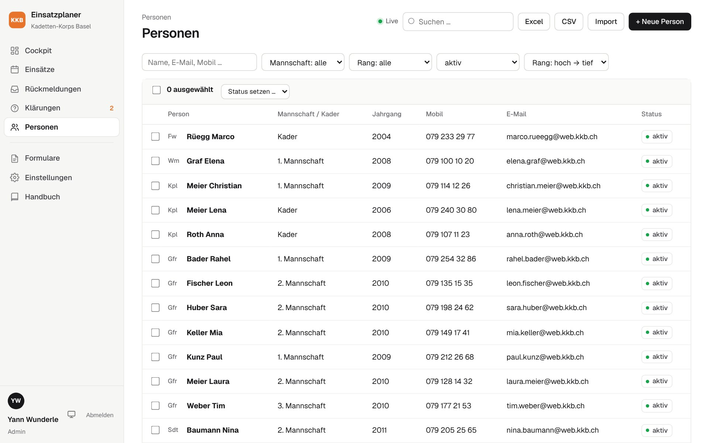

Jede Person existiert genau einmal. Anmeldungen, Anfragen und Schichten verweisen nur auf sie.

- **Suche** nach Name, E-Mail oder Mobilnummer (auch Namensvarianten), Filter nach Mannschaft, Rang und Status, Sortierung nach Rang (hoch → tief oder tief → hoch) oder Name.
- **+ Neue Person** und **Bearbeiten** öffnen das Personenformular mit Rang, Mannschaften, Jahrgang, Mobil, E-Mail, Essenseinschränkungen und interner Bemerkung.
- **Namensvarianten** wie «Chrigi» werden bei der Person gespeichert und bei Anmeldungen automatisch erkannt.
- **Status setzen** für mehrere ausgewählte Personen (aktiv, inaktiv, ausgetreten). Inaktive erscheinen nirgends mehr als Vorschlag.
- **Löschen:** Unten im Personenformular lässt sich eine Person komplett löschen – mit allen ihren Anmeldungen und Anfragen. Vorher zeigt der Einsatzplaner, was alles betroffen ist. Für Ausgetretene ist «ausgetreten» meist die bessere Wahl.

### Import aus ClubDesk

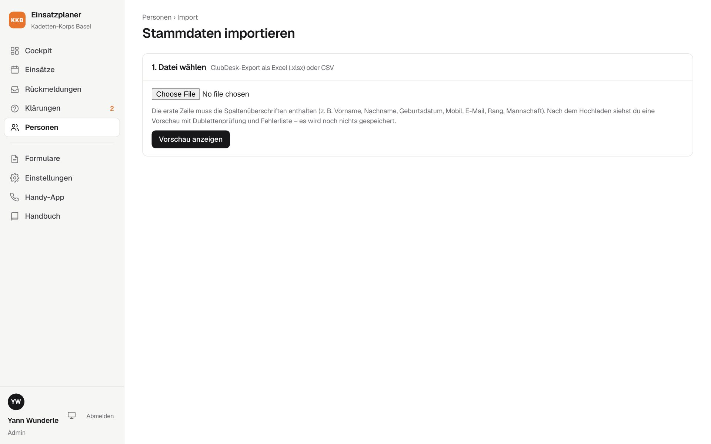

Über **Import** lässt sich ein ClubDesk-Export (Excel oder CSV) einlesen. Zuerst kommt eine Vorschau mit Spaltenzuordnung, Dublettenprüfung und Fehlerliste – gespeichert wird erst nach der Bestätigung.

> **Sensible Angaben:** Essenseinschränkungen sieht vollständig nur der Admin; die Aufgebotsstelle sieht sie nur bei Personen, die für einen Einsatz angemeldet sind. Im Anmeldeformular werden solche Angaben nie abgefragt.

## 14 · Für Admins

Unter **Einstellungen** sorgt der Admin dafür, dass die Grundlagen stimmen.

### Benutzer

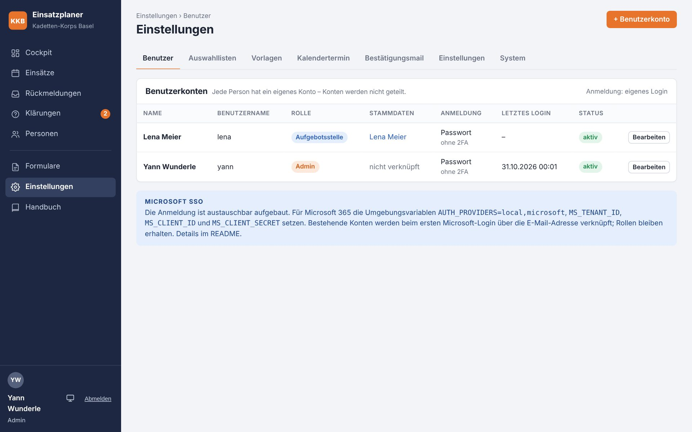

Konten anlegen, Rolle wählen (Admin oder Aufgebotsstelle) und mit einer Person aus den Stammdaten verknüpfen – daraus kommen Rang und Name als «Absender» im Aufgebot. Die Liste zeigt auch, wer die Zwei-Faktor-Anmeldung eingerichtet hat.

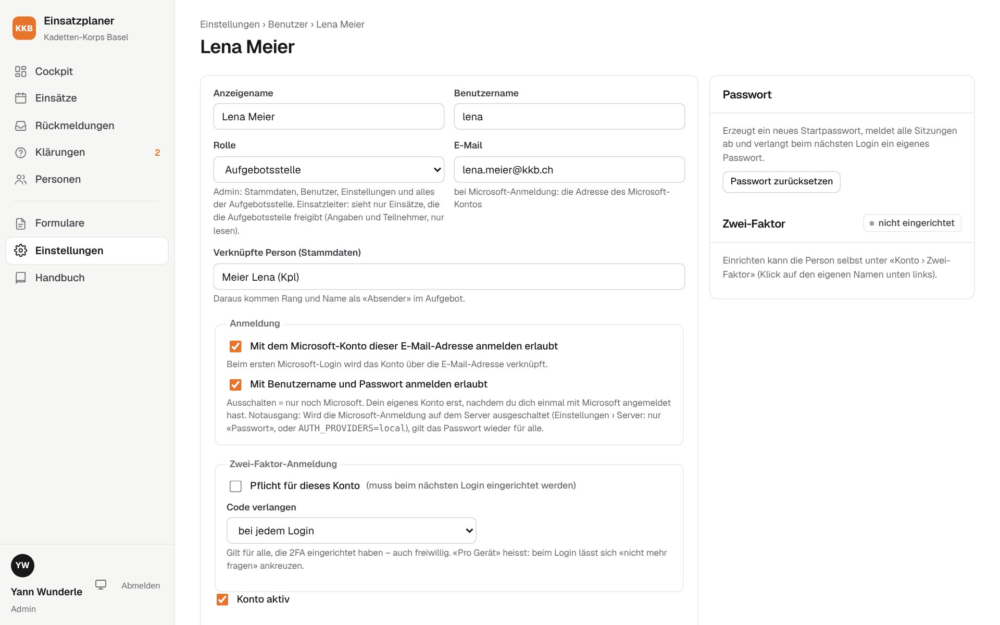

- **Passwort zurücksetzen** erzeugt ein Startpasswort, meldet alle Sitzungen ab und verlangt beim nächsten Login ein eigenes Passwort.
- **Zwei-Faktor-Anmeldung:**
  - **Pflicht für dieses Konto:** Die Person muss die 2FA beim nächsten Login einrichten. Vorher kommt sie nirgends hin.
  - **Code verlangen:** bei jedem Login, oder einmal pro Tag, Woche, Monat bzw. 3 Monate pro Gerät. Gilt für alle, die 2FA eingerichtet haben – auch freiwillig.
  - **2FA zurücksetzen,** z. B. wenn jemand sein Handy verloren hat. Danach richtet die Person sie neu ein.
- **Konto aktiv** ausschalten sperrt den Zugang, ohne Daten zu löschen.
- **Benutzerkonto löschen** entfernt das Konto endgültig. Was die Person erfasst hat (Anmeldungen, Kontaktversuche, Verlauf), bleibt mit ihrem Namen erhalten, ebenso die verknüpfte Person in den Stammdaten. Das eigene Konto und den letzten aktiven Admin kann man nicht löschen.

### Auswahllisten und Vorlagen

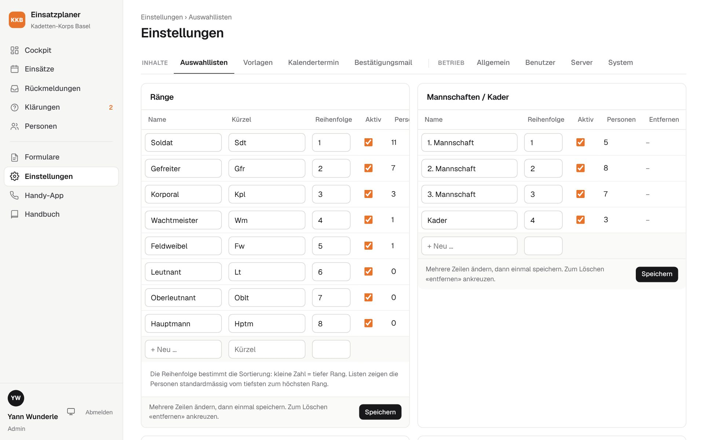

**Ränge** und **Mannschaften / Kader**. Die Reihenfolge der Ränge bestimmt die Sortierung: kleine Zahl = tiefer Rang, grosse Zahl = hoher Rang.

**Anmeldefragen**, **Tenue-Vorlagen** und **Zusatzfelder** für Einsätze (z. B. «Transport»). Jedes Zusatzfeld steht automatisch als Baustein zur Verfügung.

> **Speichern pro Abschnitt:** In Auswahllisten und Vorlagen hat jeder Abschnitt einen einzigen Speichern-Knopf. Mehrere Zeilen ändern, in der leeren Zeile etwas Neues eintragen, bei anderen «entfernen» ankreuzen – und dann einmal speichern. Geänderte Zeilen sind links orange markiert. Ränge oder Mannschaften, die noch verwendet werden, lassen sich nicht entfernen, nur deaktivieren.

### Bestätigungsmail

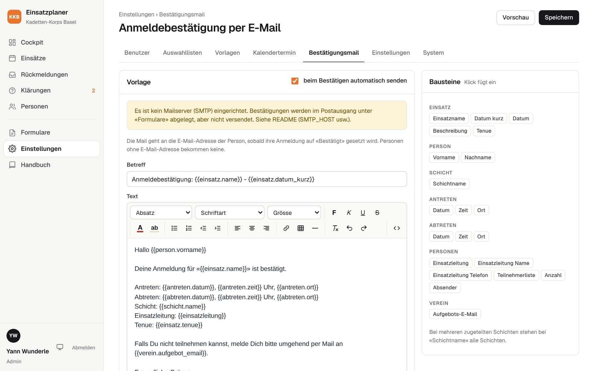

Betreff und Text der Anmeldebestätigung mit denselben Bausteinen wie im Kalendertermin. Mit **Vorschau** für einen echten Einsatz prüfen und eine **Testmail** an sich selbst schicken. Der Haken «beim Bestätigen automatisch senden» schaltet den Versand ein oder aus. Ohne eingerichteten Mailserver bleiben die Mails im Postausgang (unter «Formulare») und gehen raus, sobald er eingerichtet ist.

### Einstellungen und Datensicherung

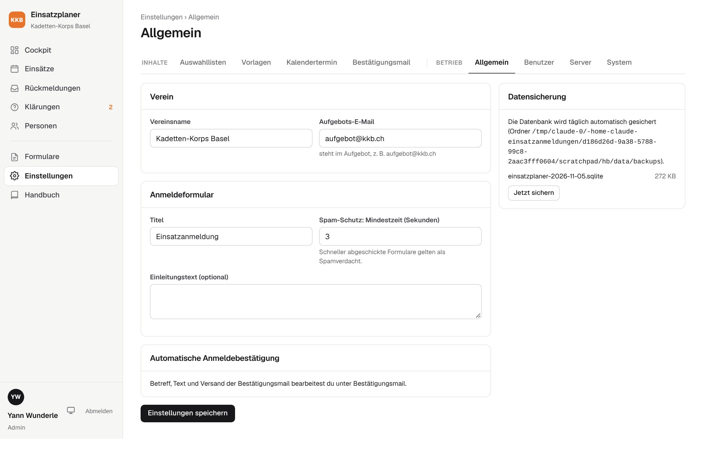

- **Verein:** Vereinsname und Aufgebots-E-Mail (steht im Aufgebot).
- **Anmeldeformular:** Titel, Einleitungstext und die Mindestzeit gegen Spam.
- **Datensicherung:** Die Datenbank wird täglich automatisch gesichert und 30 Tage aufbewahrt. **Jetzt sichern** erstellt sofort eine Sicherung.

### System: Update und Neustart

- **Nach Updates suchen** zeigt, ob es eine neue Version gibt.
- **Update installieren** sichert zuerst die Datenbank, holt dann die neue Version, installiert nötige Pakete und startet den Server neu. Das Protokoll läuft live mit. Während des Neustarts ist die Seite einige Sekunden nicht erreichbar.
- **Server neu starten**, z. B. nach Änderungen an der Konfiguration.
- **Version** zeigt Stand und Datum der installierten Version. Das Handbuch passt immer zu dieser Version.

### Formulare

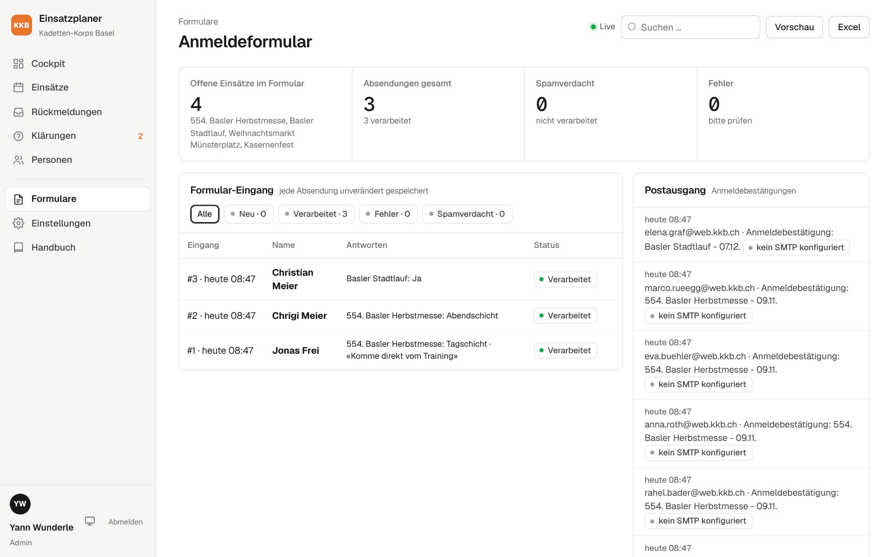

- Offene Einsätze im Formular, Absendungen, Spamverdacht und Fehler auf einen Blick.
- **Formular-Eingang:** jede Absendung unverändert gespeichert – auch wenn eine Anmeldung später gelöscht wird.
- **Einbettung in ClubDesk:** die feste Adresse des Formulars. Sie wird einmal im ClubDesk-Baustein eingebettet, danach ist auf ClubDesk nie wieder etwas zu tun.
- **Postausgang:** versendete und wartende Anmeldebestätigungen.

## 15 · Sicherheit und Zwei-Faktor-Anmeldung

Mit der Zwei-Faktor-Anmeldung reicht das Passwort allein nicht mehr. Zusätzlich braucht es einen 6-stelligen Code, den nur das eigene Handy erzeugt. Wer das Passwort errät oder mitliest, kommt so trotzdem nicht hinein.

**Einrichten:**

1. Unten links auf den eigenen Namen klicken und den Reiter **Zwei-Faktor** öffnen.
2. Auf dem Handy eine Authenticator-App installieren, z. B. Microsoft Authenticator, Google Authenticator oder die Passwort-App auf dem iPhone.
3. In der App den **QR-Code scannen** (oder den Schlüssel von Hand eingeben).
4. Den aktuellen 6-stelligen Code eingeben und **Aktivieren**.
5. Die **10 Wiederherstellungscodes** aufschreiben oder ausdrucken und sicher aufbewahren. Jeder gilt genau einmal.

**Anmelden mit 2FA:** Nach dem Passwort den Code aus der App eingeben. Je nach Einstellung lässt sich «auf diesem Gerät nicht mehr fragen» ankreuzen – dann wird der Code auf diesem Gerät erst nach der eingestellten Zeit wieder verlangt.

**Handy verloren?** Mit einem Wiederherstellungscode anmelden (statt des 6-stelligen Codes eingeben) und die 2FA neu einrichten. Ohne Wiederherstellungscode setzt ein Admin die 2FA zurück.

Weitere Schutzmassnahmen: Passwörter mit mindestens 10 Zeichen, sicher verschlüsselt gespeichert; Sperre nach 5 Fehlversuchen für 15 Minuten; automatische Abmeldung nach Inaktivität; jede Änderung ist vor fremden Seiten geschützt.

## 16 · Häufige Fragen

**Brauchen die Mitglieder ein Konto oder eine App?**
Nein. Sie öffnen das Formular auf der ClubDesk-Seite, geben Vor- und Nachnamen ein und wählen ihre Einsätze – auf jedem Handy und Computer.

**Was passiert, wenn sich jemand vertippt oder einen Spitznamen verwendet?**
Die Anmeldung geht nicht verloren. Sie landet in den Klärungen und wird dort mit wenigen Klicks zugeordnet. Mit «als Namensvariante speichern» klappt es beim nächsten Mal automatisch.

**Kann eine Anmeldung verloren gehen?**
Das Mitglied sieht die Bestätigungsseite erst, wenn die Anmeldung sicher gespeichert ist. Jede Absendung wird zusätzlich unverändert unter «Formulare» aufbewahrt, und die Daten werden täglich gesichert.

**Was ist, wenn jemand das Formular zweimal abschickt?**
Doppelte Absendungen werden erkannt. Pro Person und Einsatz gibt es höchstens eine Anmeldung.

**Ist man automatisch dabei, wenn man sich anmeldet?**
Nein. Jede Anmeldung wird von der Aufgebotsstelle bestätigt. Erst dann erhält das Mitglied seine Anmeldebestätigung.

**Was ist, wenn ein Einsatz voll ist?**
Das Cockpit weist darauf hin. Den Einsatz mit dem Schalter «Im Formular anzeigen» herausnehmen. Weitere Anmeldungen kommen auf die Warteliste.

**Ich habe einen Kontaktversuch bei der falschen Person erfasst.**
Im Reiter «Anfragen» beim letzten Kontaktversuch auf den Pfeil klicken. Er wird zurückgenommen, eine daraus erstellte Anmeldung ebenfalls.

**Jemand weiss noch nicht, ob er kommt.**
In den Rückmeldungen oder bei den Anfragen einen Kontaktversuch mit dem Ergebnis «Unsicher – weiss es noch nicht» erfassen. Er erscheint dann gelb mit «?» und bleibt ein offener Fall.

**Können mehrere Personen gleichzeitig arbeiten?**
Ja. Alle sehen live denselben Stand. Bearbeiten zwei Personen denselben Eintrag, zeigt der Einsatzplaner beide Stände an, und niemand überschreibt den anderen unbemerkt.

**Kann ich die Listen ausdrucken oder nach Excel exportieren?**
Ja. Jede Liste lässt sich drucken und als Excel- oder CSV-Datei exportieren, genau mit den eingestellten Filtern.

**Funktioniert der Einsatzplaner auf dem Handy?**
Ja. Er ist für den Computer gemacht, lässt sich aber auch auf Tablet und Handy bedienen – etwa um unterwegs einen Anruf zu erfassen.

**Woher weiss ich, ob dieses Handbuch aktuell ist?**
Oben auf der Handbuch-Seite stehen Stand und Version. Das Handbuch wird mit jedem Update mitgeliefert und passt damit immer zur installierten Version.
